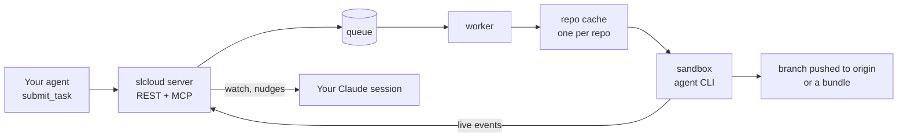

<p align="center">
  
</p>

<h1 align="center">superlite cloud</h1>

<p align="center">
  <b>Your team's superlite runs on one server. Send a task, watch it live, get a branch back.</b>
</p>

<p align="center">
  
  
  
  <a href="https://github.com/iha2/superlite-cloud/actions/workflows/tests.yml"></a>
</p>

---

superlite cloud (`slcloud`) is the server side of [superlite](https://github.com/iha2/superlite). It accepts agent tasks over REST and MCP and queues them. It runs each task in its own sandbox with the agent CLI you chose, and hands the result back as a git branch. You watch and steer the run from your own Claude session as if it were local, and your local Claude spends no tokens doing it.

## Use it

Set up the server once ([Quick start](#quick-start)), then log in from superlite on your machine:

```sh
superlite-cli cloud login
```

Login looks for the address and token in this order:

1. the command line (`--url`, `--token`)
2. the project's `.env`
3. `~/.superlite/.env`
4. your clipboard (the token only)

The settings are `SUPERLITE_CLOUD_URL` and `SUPERLITE_CLOUD_TOKEN`. The token is never printed. Login also turns on a status line that shows your current run.

### Say what you want

| Situation | Say something like | What happens |
|---|---|---|
| **Run it in the cloud** | "Run this in the cloud: fix the login redirect" | The agent submits the task through the `submit_task` MCP tool. The run gets a short name such as `login_fix` and starts with a plan |
| **Approve the plan** | `approve` | The run starts building in its sandbox, on the session branch `superlite/sessions/login-fix` |
| **Steer a run** | `>> run the tests first` | A nudge goes to your current run. `>>login_fix text` targets a named run. Claude never sees these lines |
| **Hand it over** | "Give login_fix to pat@example.com" | The run keeps going and Pat becomes its owner. Pat's status line shows `new: login_fix from chris` |
| **Get the result** | (nothing, it arrives) | When the run ends, its branch is pushed to origin. If the push fails, you get a bundle and the command to fetch it |

### Or use a command

| Command | What it does |
|---|---|
| `/superlite:runs [all]` | List your cloud runs and your local runs. Admins can add `all` to see every run in the workspace |
| `/superlite:watch <run>` | Open a live view of the run in a pane to the right. It replays from the start if the run already finished. The pane has its own input line for nudges, `/approve` and `/cancel` |
| `/superlite:attach <run>` | Every line you type goes to the run. Start a line with `\` to talk to Claude instead |
| `/superlite:detach` | Leave attach mode. Attach mode also ends when the run ends |
| `/superlite:give <run> <email>` | Hand the run to a teammate. You give by email, so it can never go to the wrong person |

Typing `/superlite:attach` or `/superlite:watch` lists your live runs with their state, for example `/superlite:attach-login_fix  running · step 14 · claude`. A dropped connection reconnects on its own and resumes where it stopped.

### Who can do what

- **Members.** Everyone in a workspace is a member with a short handle such as `chris` and an email address such as `chris@example.com`. Every token belongs to one member, and a new token keeps you the same person with the same runs.
- **One owner per run.** Only the run's owner can watch, nudge, attach, approve, cancel or give it away. Admins can do all of this on every run. The server checks this on every request, whatever client sends it.
- **Accounts.** Members register on the server's sign-in page with an invite code. On that page they sign in and make, list or revoke their own tokens.

## How a run works



- **A repo cache.** The cloud keeps one copy of each repo with its full history. A run fetches only the new commits and makes a light clone (`git clone --shared`), so a repo the cloud has seen before starts in seconds.
- **One name everywhere.** The run `login_fix` is the superlite session `login-fix` on the branch `superlite/sessions/login-fix`. If someone pushes a branch with that name while the run is live, the run is renamed to the next free name, such as `login_fix_2`, so it never overwrites anyone's branch.
- **One sandbox per run.** Each run gets its own container, with the agent CLIs pinned by version. Provider keys are encrypted at rest and only reach the sandbox as environment variables.
- **Learning rows.** Members send their superlite learning rows with `slcloud sync`. They are collected and reviewed centrally.

## Quick start

Requirements: Docker with Compose, and a git repository your tasks can clone.

1. Create the env file and set a master key. The master key encrypts stored provider keys.

   ```sh
   cp .env.example .env
   # set SLCLOUD_MASTER_KEY in .env to the output of: openssl rand -hex 32
   ```

2. Build and start the server and the worker.

   ```sh
   docker compose up -d --build
   ```

   The server listens on http://localhost:8787. The worker builds the sandbox image `slcloud-worker:0.1.0`.

3. Create a workspace. Run this inside the server container. It prints an admin token and an invite code. The token is shown once, so save it.

   ```sh
   docker compose exec server slcloud init
   ```

4. Point the client commands at the server.

   ```sh
   export SLCLOUD_URL=http://localhost:8787
   export SLCLOUD_TOKEN=slc_...   # the admin token from step 3
   ```

5. Store a provider key for the workspace. `slcloud key set` reads the key from stdin, so it stays out of your shell history. Only the last 4 characters are ever shown back.

   ```sh
   slcloud key set anthropic
   ```

6. Add your team. Create a token for each member, or give them an invite so they can register on the sign-in page.

   ```sh
   slcloud token create <workspace> <role> --member <handle> --email <email>
   slcloud invite <handle>
   ```

7. Connect each agent to the server. `slcloud connect` prints the command to run in that agent: `claude`, `codex`, `gemini` or `cursor`.

   ```sh
   slcloud connect claude
   ```

8. Send learning rows to the server. Sync keeps an offset, so running it again sends only new rows.

   ```sh
   slcloud sync
   ```

## Server commands

| Command | What it does |
|---|---|
| `slcloud init [name] [--member <handle>]` | Create a workspace and print its admin token and invite |
| `slcloud token create <workspace> <role> --member <handle>` | Make a token for a member. The role is `admin` or `member` |
| `slcloud member ...`, `slcloud invite <handle>` | Manage members: lock them, rename them, invite them |
| `slcloud key set <provider>` | Store a provider key, read from stdin |
| `slcloud connect <agent>` | Print the command that connects an agent to this server |
| `slcloud sync` | Send new learning rows |
| `slcloud backup`, `slcloud restore` | Copy the database out, or put a copy back. Restore needs the server and worker stopped |
| `slcloud serve`, `slcloud worker` | Run the server or the worker (Compose does this for you) |

## Configuration

Set these in `.env`. Provider keys are never set here: store them with `slcloud key set`.

| Setting | Default | What it does |
|---|---|---|
| `SLCLOUD_MASTER_KEY` | (required) | Encrypts stored provider keys. Generate with `openssl rand -hex 32` |
| `SLCLOUD_URL` | `http://localhost:8787` | The public URL agents and browsers use |
| `SLCLOUD_DOMAIN` | empty | Host name for the optional https profile (Caddy) |
| `SLCLOUD_WORK` | `/srv/slcloud/work` | Task workdir root, the same path on the host and in the worker |
| `SLCLOUD_SANDBOX` | `docker` | `docker`, or `process` to run without containers |
| `SLCLOUD_GVISOR` | `0` | `1` runs sandboxes under gVisor (`runsc`) if it is installed |
| `SLCLOUD_DOCKER_BIN` | `docker` | The container CLI for sandboxes: `docker` or `podman` |
| `SLCLOUD_WORKER_IMAGE` | `slcloud-worker:0.1.0` | The sandbox image |

### Using Podman

Set `SLCLOUD_DOCKER_BIN=podman` and point `DOCKER_HOST` at the Podman API socket, for example `DOCKER_HOST=unix:///run/user/1000/podman/podman.sock`. `podman info` prints the socket path. `DOCKER_HOST`, `DOCKER_CONTEXT`, `DOCKER_CONFIG`, `DOCKER_CERT_PATH` and `DOCKER_TLS_VERIFY` are passed through to the CLI. Job secrets are never passed to it except as `-e NAME` for the sandbox.

## Layout

- `src/slcloud/` is the package. The CLI entry point is `slcloud`.
- `src/slcloud/drivers/` holds one driver per agent CLI: Claude, Codex, Gemini and Cursor.
- `Dockerfile` builds the server image. `Dockerfile.worker` builds the worker and sandbox image, with the agent CLIs and superlite pinned by version.
- `compose.yaml` defines the `server` and `worker` services. `Caddyfile` is the optional https front.

## Development

```sh
uv venv --python 3.12 && uv pip install -e '.[dev]'
.venv/bin/python -m pytest -q -m "not slow"
```

## Security

Read [SECURITY.md](SECURITY.md) before you expose the server. It covers how sandboxes are isolated, why the worker holds the Docker socket, and how keys are stored.

## License

MIT. See [LICENSE](LICENSE).
