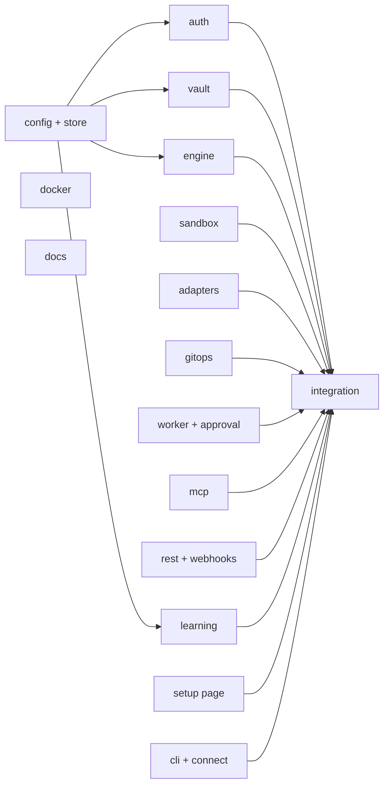
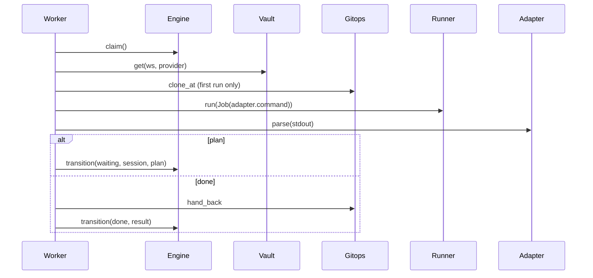

# superlite.cloud core server

**Goal:** A self-hostable server that runs superlite builds in sandboxes for a team, driven from local agents over remote MCP, with plan approval, git hand-back and team learning.
**Architecture:** Python package `slcloud` (src layout). SQLite store; engine moves task states; a worker claims tasks and runs an agent CLI in a sandbox; FastAPI serves REST, the setup page and the FastMCP app at `/mcp`.
**Tech stack:** Python 3.12, FastAPI, uvicorn, mcp (FastMCP), cryptography, httpx, pytest, pyyaml (dev)
**Detail:** contracts
**Full suite:** no
**Target-min:** 14
**Ignore:** .venv/, *.db, work/
**Review plan:** docs/plans/2026-11-14-superlite-cloud-core.review.md

## Global constraints

- language: python >=3.12; package `slcloud` in `src/slcloud/`; tests in `tests/`; test command: `.venv/bin/python -m pytest -q -m "not slow"`; Wave 0 runs `uv venv --python 3.12 && uv pip install -e '.[dev]'`
- deps: fastapi, uvicorn, mcp>=1.10, cryptography, httpx; dev: pytest, pyyaml. Console script `slcloud = slcloud.cli:main`
- `src/slcloud/errors.py` (Wave 0): `NotFound`, `BadTransition`, `Rejected`, `Forbidden`, all `Exception` subclasses
- statuses: `queued running waiting done failed cancelled`; ids `t_` + 12 hex; tokens `slc_` + 32 hex, stored as sha256 hex; roles `admin` | `member`
- agents → provider → key env: claude→anthropic→ANTHROPIC_API_KEY, codex→openai→OPENAI_API_KEY, gemini→gemini→GEMINI_API_KEY, cursor→cursor→CURSOR_API_KEY
- a plan pause is agent text containing `Reply approve to start`
- secrets never appear in logs, events, errors or API output; keys show last 4 only
- the Claude adapter always passes `--bare`; sandboxes get only the task workdir and that task's one key env
- no network calls in fast tests: HTTP, subprocess and docker are injected callables or fakes

## File structure

config.py settings · store.py SQLite and schema · auth.py tokens, middleware · vault.py keys · engine.py task states · sandbox.py runners · adapters.py agent CLIs · gitops.py clone and hand-back · worker.py run and approval · mcp_server.py tools · api.py REST · webhooks.py signing · learning.py rows, lessons · setup.py + static/setup.html · keytest.py · connect.py · cli.py · app.py composition · Dockerfile, Dockerfile.worker, compose.yaml · README.md, LICENSE, SECURITY.md

## Core

### T1 config + store · Complexity 3 · Est. context 26k
**Owns:** src/slcloud/config.py, src/slcloud/store.py, tests/test_store.py
**Components:** 2
**LOC owned:** 130
**Tests:** fast
**Kind:** mechanical
**Model:** haiku
**Consumes:** none
**Produces:** config.load_settings(env: dict[str, str]) -> Settings · store.Store(path: str) · Store.query(sql: str, params: tuple = ()) -> list[dict] · Store.exec(sql: str, params: tuple = ()) -> int
e.g. load_settings({"SLCLOUD_DATA": "/d", "SLCLOUD_MASTER_KEY": "k"}) -> Settings(data_dir="/d", db_path="/d/slcloud.db", work_dir="/d/work", master_key="k", public_url="http://localhost:8787", sandbox="docker", worker_image="slcloud-worker:0.1.0", gvisor=False)
e.g. Store(":memory:").exec("INSERT INTO workspaces(id,name,created) VALUES(?,?,?)", ("w1", "team", "2026-11-14")) -> 1; then query("SELECT id FROM workspaces") -> [{"id": "w1"}]
**Review Focus:** test_missing_master_key: `load_settings({})` raises ValueError; test_gvisor_flag: SLCLOUD_GVISOR="1" gives True; test_schema_tables: tables workspaces, tokens, keys, tasks, events, learn_rows, lessons, webhooks exist; test_learn_unique: duplicate (workspace, member, rid) insert raises sqlite3.IntegrityError
**Test code (contracts):** the four above plus test_defaults (the e.g. values) and test_exec_returns_rowcount
**Notes:** env keys SLCLOUD_DATA (default /data), SLCLOUD_WORK, SLCLOUD_MASTER_KEY, SLCLOUD_URL, SLCLOUD_SANDBOX (docker|process), SLCLOUD_WORKER_IMAGE, SLCLOUD_GVISOR. `Store` sets `row_factory`, WAL, `check_same_thread=False`, a lock, and runs the schema on open. Columns: tokens(hash, workspace, role, created); keys(workspace, provider, ciphertext, last4); tasks(id, workspace, repo, prompt, agent, base, status, session, plan, answer, result, error, created, updated); events(id, task, kind, data, at); learn_rows(workspace, member, rid, signal, row, at); lessons(id, workspace, text, proposed_by, status, approved_by, created); webhooks(id, workspace, url, secret).

### T2 auth · Complexity 5 · Est. context 30k
**Owns:** src/slcloud/auth.py, tests/test_auth.py
**Components:** 2
**LOC owned:** 120
**Tests:** fast
**Model:** sonnet
**Consumes:** store.Store(path: str) (T1)
**Produces:** auth.create_workspace(store: Store, name: str) -> str · auth.create_token(store: Store, workspace: str, role: str) -> str · auth.check_token(store: Store, token: str) -> Principal | None · auth.current_principal() -> Principal · auth.BearerMiddleware(app, store: Store)
e.g. check_token(store, tok) -> Principal(workspace="w_ab12", role="admin", member="9f2c1a7e") (member = first 8 hex of the token hash)
e.g. check_token(store, "slc_wrong") -> None
e.g. current_principal() inside a request authed with tok -> Principal(workspace="w_ab12", role="admin", member="9f2c1a7e")
**Review Focus:** test_hash_only_stored: the raw token never appears in the tokens table; test_middleware_401: `/api/tasks` with no or a bad header gives 401 {"error": "unauthorized"}; test_public_paths: `/api/health` and `/setup` need no token; test_principal_set: a handler under `/mcp` sees `current_principal()` and `request.state.principal`
**Test code (contracts):** the four above plus test_roles (role other than admin|member raises ValueError)
**Notes:** compare hashes with `hmac.compare_digest`. The middleware is pure ASGI, sets a ContextVar and `scope["state"]["principal"]`.

### T3 vault · Complexity 4 · Est. context 26k
**Owns:** src/slcloud/vault.py, tests/test_vault.py
**Components:** 1
**LOC owned:** 80
**Tests:** fast
**Model:** sonnet
**Consumes:** store.Store(path: str) (T1)
**Produces:** vault.Vault(store: Store, master_key: str) · Vault.set(workspace: str, provider: str, key: str) -> str · Vault.get(workspace: str, provider: str) -> str | None · Vault.list(workspace: str) -> list[dict] · vault.mask(text: str, secrets: list[str]) -> str
e.g. Vault.set("w1", "anthropic", "sk-ant-xyz1234") -> "1234"; list("w1") -> [{"provider": "anthropic", "last4": "1234"}]
e.g. Vault.get("w1", "anthropic") -> "sk-ant-xyz1234"; Vault.get("w1", "openai") -> None
e.g. Vault.list("w1") -> [{"provider": "anthropic", "last4": "1234"}]
e.g. mask("err sk-ant-xyz1234 bad", ["sk-ant-xyz1234"]) -> "err ***1234 bad"
**Review Focus:** test_ciphertext_not_plain; test_wrong_master_key: get with another master key raises Rejected; test_other_workspace_none; test_mask_empty_secret: mask("a", [""]) -> "a"; test_unknown_provider raises ValueError
**Test code (contracts):** the five above plus test_set_overwrites
**Notes:** Fernet key = urlsafe_b64encode(sha256(master_key)).

### T4 engine · Complexity 6 · Est. context 34k
**Owns:** src/slcloud/engine.py, tests/test_engine.py
**Components:** 2
**LOC owned:** 190
**Tests:** fast
**Model:** sonnet
**Consumes:** store.Store(path: str) (T1)
**Produces:** engine.Task · Task.public() -> dict · engine.Engine(store: Store, notify=None) · Engine.submit(ws: str, repo: str, prompt: str, agent: str, base: str) -> Task · Engine.get(ws: str, task_id: str) -> Task · Engine.list(ws: str) -> list[Task] · Engine.claim() -> Task | None · Engine.transition(task_id: str, status: str, **fields) -> Task · Engine.respond(ws: str, task_id: str, answer: str) -> Task · Engine.cancel(ws: str, task_id: str) -> Task · Engine.events(task_id: str) -> list[dict]
e.g. submit("w1", "https://g/r.git", "add x", "claude", "HEAD").public() -> {"id": "t_0123456789ab", "repo": "https://g/r.git", "prompt": "add x", "agent": "claude", "base": "HEAD", "status": "queued", "plan": None, "result": None, "error": None, "created": "...", "updated": "..."}
e.g. respond on a waiting task -> status "queued", answer stored, session kept
e.g. events(id) -> [{"kind": "status", "data": {"to": "queued"}, "at": "..."}]
e.g. Task.public() -> the dict above (never ws, session or answer)
e.g. Engine.claim() -> Task(id="t_0123456789ab", status="running", ...) for the oldest queued task; with none queued -> None
e.g. Engine.transition("t_0123456789ab", "waiting", session="s1", plan="1. add x") -> Task(status="waiting", session="s1", plan="1. add x"); "done" -> "queued" raises BadTransition
e.g. Engine.get("w1", "t_0123456789ab") -> Task(id="t_0123456789ab", status="queued"); Engine.get("w2", same id) raises NotFound
e.g. Engine.list("w1") -> [Task(id="t_0123456789ab", ...)] newest first; Engine.list("w2") -> []
e.g. Engine.respond("w1", "t_0123456789ab", "approve") -> Task(status="queued", answer="approve", session="s1"); on a non-waiting task raises BadTransition
e.g. Engine.cancel("w1", "t_0123456789ab") -> Task(status="cancelled"); on a done task raises BadTransition
**Review Focus:** test_bad_transition: done → running raises BadTransition; test_cross_workspace: get("w2", id of w1) raises NotFound; test_claim_oldest_once: two claims return different tasks, a third None; test_respond_needs_waiting raises BadTransition; test_unknown_agent raises ValueError; test_notify_called on each status change; test_cancel_running
**Test code (contracts):** the above plus test_submit_public (e.g. 1)
**Notes:** allowed: queued→running|cancelled, running→waiting|done|failed|cancelled, waiting→queued|cancelled. `claim` is one `UPDATE ... WHERE id = (SELECT ... ORDER BY created LIMIT 1) AND status='queued'` under the store lock. `result` is JSON. Fields: session, plan, answer, result, error.

### T5 sandbox · Complexity 5 · Est. context 28k
**Owns:** src/slcloud/sandbox.py, tests/test_sandbox.py
**Components:** 2
**LOC owned:** 130
**Tests:** fast
**Model:** sonnet
**Consumes:** none
**Produces:** sandbox.Job(image: str, command: list[str], env: dict[str, str], workdir: str, timeout_s: int = 3600, cpus: float = 2.0, memory: str = "4g") · sandbox.JobResult(code: int, stdout: str, stderr: str, timed_out: bool) · sandbox.ProcessRunner() · ProcessRunner.run(job: Job) -> JobResult · sandbox.DockerRunner(gvisor: bool = False, run=subprocess.run) · DockerRunner.argv(job: Job) -> list[str] · DockerRunner.run(job: Job) -> JobResult · sandbox.get_runner(kind: str, gvisor: bool = False)
e.g. ProcessRunner().run(Job("x", ["sh", "-c", "echo hi"], {}, "/tmp")) -> JobResult(code=0, stdout="hi\n", stderr="", timed_out=False)
e.g. DockerRunner().argv(job) starts ["docker", "run", "--rm", "--cpus", "2.0", "--memory", "4g", "--pids-limit", "512", "--cap-drop", "ALL", "--security-opt", "no-new-privileges", "-v", "/w:/work", "-w", "/work"] then "-e", "K" per env key, then image and command
**Review Focus:** test_timeout: `sleep 5` with timeout_s=1 gives timed_out True, code -1; test_gvisor_runtime adds "--runtime", "runsc"; test_env_values_not_in_argv: values passed through the run env, argv has names only; test_no_docker_sock: argv never contains "docker.sock"; test_process_env_minimal: only PATH, HOME and job.env
**Test code (contracts):** the above plus test_get_runner ("process" → ProcessRunner, "docker" → DockerRunner, else ValueError)

### T6 adapters · Complexity 5 · Est. context 30k
**Owns:** src/slcloud/adapters.py, tests/test_adapters.py
**Components:** 2
**LOC owned:** 160
**Tests:** fast
**Model:** sonnet
**Consumes:** none
**Produces:** adapters.AgentResult(text: str, session: str | None, plan: str | None, ok: bool) · adapters.get_adapter(name: str) -> AgentAdapter · AgentAdapter.command(prompt: str, resume: str | None) -> list[str] · AgentAdapter.parse(stdout: str) -> AgentResult
e.g. get_adapter("claude").command("go", None) -> ["claude", "-p", "--bare", "--plugin-dir", "/opt/superlite", "--output-format", "stream-json", "--verbose", "--permission-mode", "acceptEdits", "go"]; with resume "s1" adds "--resume", "s1" before the prompt
e.g. get_adapter("claude").parse('{"type":"result","result":"Plan ready. Reply approve to start","session_id":"s1","is_error":false}') -> AgentResult(text="Plan ready. Reply approve to start", session="s1", plan="Plan ready. Reply approve to start", ok=True)
e.g. get_adapter("codex").command("go", "th1") -> ["codex", "exec", "resume", "th1", "--json", "--full-auto", "go"]; attrs name, provider, key_env, supports_resume (claude, codex True; gemini, cursor False)
**Review Focus:** test_codex_parse: thread.started thread_id → session, last item.completed agent_message text → text; test_gemini_json: {"response": "ok"} → text "ok", session None; test_cursor_json: {"result": "ok", "session_id": "c1"}; test_garbage_stdout: ok False, no exception; test_unknown_agent raises ValueError; test_no_resume_support: gemini.command("go", "s") raises ValueError
**Test code (contracts):** the above plus the three e.g. lines
**Notes:** gemini: ["gemini", "-p", prompt, "--output-format", "json", "--yolo"]; cursor: ["cursor-agent", "-p", prompt, "--output-format", "json", "--force"]; codex fresh: ["codex", "exec", "--json", "--full-auto", "--skip-git-repo-check", prompt].

### T7 gitops · Complexity 5 · Est. context 28k
**Owns:** src/slcloud/gitops.py, tests/test_gitops.py
**Components:** 1
**LOC owned:** 120
**Tests:** slow
**Model:** sonnet
**Consumes:** none
**Produces:** gitops.HandBack(branch: str, sha: str, pushed: bool, bundle: str | None, fetch: str) · gitops.clone_at(repo: str, base: str, dest: str) -> str · gitops.hand_back(workdir: str, branch: str, out_dir: str, push: bool = True) -> HandBack
e.g. clone_at("/tmp/r.git", "HEAD", "/w/t1") -> "3f2a..." (40-hex sha of base)
e.g. hand_back("/w/t1", "slcloud/t_1", "/out", push=True) -> HandBack(branch="slcloud/t_1", sha="9c1e...", pushed=True, bundle=None, fetch="git fetch origin slcloud/t_1 'refs/superlite/*:refs/superlite/*'")
e.g. push fails -> pushed=False, bundle="/out/t_1.bundle", fetch="git fetch <bundle-url> slcloud/t_1"
**Review Focus:** test_superlite_refs_pushed: refs/superlite/x in the workdir reach the bare remote; test_bundle_fallback: unreachable remote gives a bundle that `git bundle verify` accepts; test_bad_base raises Rejected; test_repo_arg_injection: repo "--upload-pack=x" raises Rejected
**Test code (contracts):** the above plus test_clone_at_sha (local bare repo fixture)
**Notes:** git runs with `GIT_TERMINAL_PROMPT=0` and `--` before user arguments.

### T8 worker + approval · Complexity 7 · Est. context 36k

**Owns:** src/slcloud/worker.py, tests/test_worker.py
**Components:** 2
**LOC owned:** 170
**Tests:** fast
**Model:** sonnet
**Consumes:** Engine.claim() -> Task | None (T4) · Engine.transition(task_id: str, status: str, **fields) -> Task (T4) · Vault.get(workspace: str, provider: str) -> str | None (T3) · vault.mask(text: str, secrets: list[str]) -> str (T3) · sandbox.ProcessRunner() (T5) · sandbox.JobResult(code: int, stdout: str, stderr: str, timed_out: bool) (T5) · get_adapter(name: str) -> AgentAdapter (T6) · gitops.clone_at(repo: str, base: str, dest: str) -> str (T7) · gitops.hand_back(workdir: str, branch: str, out_dir: str, push: bool = True) -> HandBack (T7)
**Produces:** worker.Deps(engine, vault, runner, settings, clone=gitops.clone_at, hand_back=gitops.hand_back) · worker.run_task(task: Task, deps: Deps) -> Task · worker.loop_once(deps: Deps) -> bool
e.g. loop_once(deps) with no queued task -> False
e.g. run_task on fake stdout with "Reply approve to start" -> transition(id, "waiting", session="s1", plan=<text>)
**Review Focus:** test_no_key_fails: error "no anthropic key", runner never called; test_resume_uses_answer: a task with session and answer "approve" runs command("approve", "s1") and does not clone again; test_key_masked: key in stderr is masked in error; test_nonzero_exit_failed; test_timed_out_failed with error "timed out"; test_no_resume_agent_ai_notice: gemini prompt starts "Run `superlite-cli orchestrator set ai` first." and an event notes it; test_done_result: result equals hand_back fields as a dict
**Test code (contracts):** the above with fakes (FakeEngine records transitions; FakeRunner returns JobResult; fake clone/hand_back)
**Notes:** workdir `settings.work_dir/<task id>`, bundles to `settings.data_dir/bundles`; Job env holds only `{adapter.key_env: key}`; error text cut to the last 2000 chars.

## Interfaces

### T9 mcp · Complexity 5 · Est. context 32k
**Owns:** src/slcloud/mcp_server.py, tests/test_mcp.py
**Components:** 1
**LOC owned:** 130
**Tests:** fast
**Model:** sonnet
**Consumes:** Engine.submit(ws: str, repo: str, prompt: str, agent: str, base: str) -> Task (T4) · Engine.get(ws: str, task_id: str) -> Task (T4) · Engine.list(ws: str) -> list[Task] (T4) · Engine.respond(ws: str, task_id: str, answer: str) -> Task (T4) · Engine.cancel(ws: str, task_id: str) -> Task (T4) · Task.public() -> dict (T4) · learning.lessons(store: Store, ws: str) -> list[dict] (T11) · auth.current_principal() -> Principal (T2)
**Produces:** mcp_server.tools(engine: Engine, store: Store, settings: Settings, whoami) -> dict · mcp_server.build_mcp(engine: Engine, store: Store, settings: Settings) -> FastMCP
e.g. tools(...)["submit_task"](repo="r", prompt="p") -> {"task_id": "t_0123456789ab", "status": "queued"}
**Review Focus:** test_tool_names: submit_task, get_task, list_tasks, respond, cancel_task, fetch_command, team_lessons; test_other_workspace: get_task on another workspace's id returns {"error": "not found"}; test_fetch_bundle: a bundle result gives "<public_url>/api/tasks/<id>/bundle"; test_fetch_not_done: {"error": "task is not done"}
**Test code (contracts):** the above with a fake engine returning T4's e.g. values
**Notes:** `FastMCP("slcloud", stateless_http=True, json_response=True)`; build_mcp registers each tools() function with `whoami=auth.current_principal`.

### T10 rest + webhooks · Complexity 6 · Est. context 36k
**Owns:** src/slcloud/api.py, src/slcloud/webhooks.py, tests/test_api.py
**Components:** 2
**LOC owned:** 210
**Tests:** slow
**Model:** sonnet
**Consumes:** the Engine methods (T4) · learning.ingest(store: Store, ws: str, member: str, rows: list[dict]) -> dict (T11) · learning.totals(store: Store, ws: str) -> dict (T11) · learning.propose(store: Store, ws: str, member: str, text: str) -> dict (T11) · learning.approve(store: Store, ws: str, lesson_id: str, admin: str) -> dict (T11) · learning.withdraw(store: Store, ws: str, lesson_id: str) -> dict (T11) · learning.lessons(store: Store, ws: str) -> list[dict] (T11)
**Produces:** api.create_app(settings: Settings, store: Store, engine: Engine, whoami) -> FastAPI · webhooks.sign(secret: str, body: bytes) -> str · webhooks.Notifier(store: Store, post=httpx.post) · Notifier.__call__(task: Task) -> None
e.g. sign("s", b"{}") -> "sha256=" + hmac_sha256_hex("s", b"{}")
**Review Focus:** routes: POST/GET /api/tasks, GET /api/tasks/{id}, POST …/respond, POST …/cancel, GET …/events, GET …/bundle, POST /api/learn/rows, GET /api/learn/totals, GET/POST /api/lessons, POST /api/lessons/{id}/approve|withdraw, POST /api/webhooks, GET /api/health. test_member_cannot_approve: 403; test_not_found_404: NotFound → 404 {"error": "not found"}; test_bad_transition_409; test_rejected_row_400 lists the bad fields; test_notifier_signature header X-Slcloud-Signature; test_notifier_post_failure_swallowed
**Test code (contracts):** the above with fakes and a `whoami` lambda

### T11 learning · Complexity 5 · Est. context 30k
**Owns:** src/slcloud/learning.py, tests/test_learning.py
**Components:** 2
**LOC owned:** 150
**Tests:** fast
**Model:** sonnet
**Consumes:** store.Store(path: str) (T1)
**Produces:** learning.accept_row(row: dict) -> dict · learning.ingest(store: Store, ws: str, member: str, rows: list[dict]) -> dict · learning.totals(store: Store, ws: str) -> dict · learning.propose(store: Store, ws: str, member: str, text: str) -> dict · learning.approve(store: Store, ws: str, lesson_id: str, admin: str) -> dict · learning.withdraw(store: Store, ws: str, lesson_id: str) -> dict · learning.lessons(store: Store, ws: str) -> list[dict] · learning.outbox_rows(path: str, offset: int) -> tuple[list[dict], int]
e.g. ingest(s, "w1", "m1", [{"v": 1, "id": "a", "signal": "rework", "date": "2026-11-14"}]) -> {"accepted": 1, "duplicate": 0}; the same call again -> {"accepted": 0, "duplicate": 1}
e.g. propose(s, "w1", "m1", "run lint first") -> {"id": "l_1a2b3c4d", "status": "held", "proposed_by": "m1"}; lessons(s, "w1") -> [] until approve, then [{"id": "l_1a2b3c4d", "text": "run lint first", "proposed_by": "m1", "approved_by": "m2"}]
e.g. totals(s, "w1") -> {"rework": 1}
e.g. learning.approve(s, "w1", "l_1a2b3c4d", "m2") -> {"id": "l_1a2b3c4d", "status": "approved", "approved_by": "m2"}; an unknown id raises NotFound
e.g. learning.withdraw(s, "w1", "l_1a2b3c4d") -> {"id": "l_1a2b3c4d", "status": "withdrawn"}
e.g. learning.lessons(s, "w1") -> [{"id": "l_1a2b3c4d", "text": "run lint first", "proposed_by": "m1", "approved_by": "m2"}] (approved only)
e.g. learning.outbox_rows("/o.jsonl", 0) -> ([{"v": 1, "id": "a", "signal": "rework", "date": "2026-11-14"}], 58); outbox_rows("/o.jsonl", 58) -> ([], 58)
**Review Focus:** test_extra_field_rejected: a row with "file" raises Rejected naming it; test_whole_batch_rejected: one bad row stores nothing; test_missing_id_rejected; test_withdrawn_hidden; test_outbox_offset: a second call from the returned offset returns only new lines; test_partial_last_line_waits: a line without a newline is not returned; test_lessons_other_workspace_empty
**Test code (contracts):** the above plus the e.g. lines
**Notes:** OUTBOX_FIELDS = v, date, repo, superlite, signal, id, tool, count, requested, ran, run.

### T12 setup page · Complexity 5 · Est. context 32k
**Owns:** src/slcloud/setup.py, src/slcloud/keytest.py, src/slcloud/static/setup.html, tests/test_setup.py
**Components:** 3
**LOC owned:** 230
**Tests:** slow
**Model:** sonnet
**Consumes:** Vault.set(workspace: str, provider: str, key: str) -> str (T3) · Vault.list(workspace: str) -> list[dict] (T3) · connect.connect_command(agent: str, url: str, token: str) -> str (T13)
**Produces:** keytest.test_key(provider: str, key: str, get=httpx.get) -> tuple[bool, str] · setup.make_router(vault: Vault, settings: Settings, whoami, run=subprocess.run, test_key=keytest.test_key) -> APIRouter
e.g. test_key("anthropic", "k", get=fake200) -> (True, "works"); a 401 -> (False, "<provider error message>")
**Review Focus:** routes GET /setup (HTML), GET /api/agents → [{"name": "claude", "version": "2.1.3", "superlite": "4.1.0"}], POST /api/agents/{name}/check, GET /api/keys, PUT /api/keys/{provider} {"key"} → {"provider", "last4", "works", "message"}, GET /api/connect?agent=claude → {"command"}. test_put_key_never_echoes; test_failed_key_not_stored; test_member_cannot_set_key 403; test_cursor_not_checked: (True, "not checked"); test_html_no_inline_key: setup.html escapes text with textContent
**Test code (contracts):** the above with fake run, fake get and a fake vault
**Notes:** anthropic GET https://api.anthropic.com/v1/models (x-api-key, anthropic-version 2023-06-01); openai GET https://api.openai.com/v1/models (Bearer); gemini GET https://generativelanguage.googleapis.com/v1beta/models (x-goog-api-key). Page: one HTML file, no framework, token kept in sessionStorage.

### T13 cli + connect · Complexity 4 · Est. context 30k
**Owns:** src/slcloud/cli.py, src/slcloud/connect.py, src/slcloud/__main__.py, tests/test_cli.py
**Components:** 2
**LOC owned:** 180
**Tests:** fast
**Model:** sonnet
**Consumes:** learning.outbox_rows(path: str, offset: int) -> tuple[list[dict], int] (T11)
**Produces:** connect.connect_command(agent: str, url: str, token: str) -> str · cli.main(argv: list[str] | None = None) -> int
e.g. connect_command("claude", "http://h:8787", "slc_ab") -> 'claude mcp add --transport http slcloud http://h:8787/mcp --header "Authorization: Bearer slc_ab"'
e.g. connect_command("codex", "http://h:8787", "slc_ab") -> 'export SLCLOUD_TOKEN=slc_ab && codex mcp add slcloud --url http://h:8787/mcp --bearer-token-env-var SLCLOUD_TOKEN'
**Review Focus:** test_gemini_connect: 'gemini mcp add --transport http slcloud http://h:8787/mcp --header "Authorization: Bearer slc_ab"'; test_cursor_connect: a JSON snippet {"mcpServers": {"slcloud": {"url": ".../mcp", "headers": {"Authorization": "Bearer slc_ab"}}}}; test_sync_once: offset saved only after HTTP 200, a second sync sends nothing; test_sync_failure_keeps_offset; test_key_set_reads_stdin, key never printed; test_unknown_command exit 2
**Test code (contracts):** the above with an injected HTTP poster
**Notes:** commands init, token create, key set, connect, sync, serve, worker. Client commands read SLCLOUD_URL and SLCLOUD_TOKEN. Sync state `~/.config/slcloud/sync.json` keyed by URL. `init`, `serve` and `worker` call app.py and are tested in T16.

## Delivery

### T14 docker · Complexity 3 · Est. context 22k
**Owns:** Dockerfile, Dockerfile.worker, compose.yaml, .dockerignore, .env.example, tests/test_packaging.py
**Components:** 2
**LOC owned:** 110
**Tests:** fast
**Kind:** mechanical
**Model:** haiku
**Consumes:** none
**Produces:** compose.yaml services server and worker
**Review Focus:** test_compose_services: server port "8787:8787", volume at /data, worker command `slcloud worker`; test_pinned: Dockerfile.worker ARGs CLAUDE_VERSION, CODEX_VERSION, GEMINI_VERSION, SUPERLITE_VERSION each have a value and no file says "latest"; test_sandbox_image_no_sock: only the worker service mounts /var/run/docker.sock
**Test code (contracts):** the three above (pyyaml)
**Notes:** pin to `npm view <pkg> version` at build time (@anthropic-ai/claude-code, @openai/codex, @google/gemini-cli); superlite from git tag v4.1.0 into /opt/superlite; cursor-agent by its installer. SLCLOUD_WORK is bind-mounted at the same path on host and worker.

### T15 docs · Complexity 2 · Est. context 20k
**Owns:** README.md, LICENSE, SECURITY.md, tests/test_docs.py
**Components:** 1
**LOC owned:** 140
**Tests:** fast
**Kind:** mechanical
**Model:** haiku
**Consumes:** none
**Produces:** README.md quick start
**Review Focus:** test_readme_commands: README names `docker compose up`, `slcloud init`, `slcloud key set`, `slcloud connect`, `slcloud sync`; test_license_mit; test_security_mentions: SECURITY.md mentions `--bare`, docker.sock and API keys only
**Test code (contracts):** the three above

### T16 integration · Complexity 6 · Est. context 40k
**Owns:** src/slcloud/app.py, tests/test_e2e.py, tests/test_probe_glue.py
**Components:** 2
**LOC owned:** 170
**Tests:** slow
**Model:** sonnet
**Consumes:** every Produces above
**Produces:** app.build(settings: Settings, runner=None) -> FastAPI · app.init_workspace(settings: Settings, name: str) -> tuple[str, str]
e.g. init_workspace(s, "team") -> ("w_ab12cd34", "slc_<32 hex>")
**Review Focus:** test_flow_approve: a fake `claude` on PATH (ProcessRunner) prints a plan, the task waits, POST respond "approve", the second run commits, the task is done and the branch is in the bare remote; test_changes_revised_plan; test_mcp_over_http: tools/list and tools/call submit_task over POST /mcp with the bearer token; test_401_and_cross_workspace_404; test_docker_e2e (skipped unless SLCLOUD_DOCKER_E2E=1)
**Test code (contracts):** the above
**Notes:** build() wires Notifier into Engine, BearerMiddleware, the setup router and the MCP app at /mcp with a lifespan that runs `mcp.session_manager.run()`.

**Probe entry:** call=slcloud.learning.accept_row · run=python -m slcloud · serve=slcloud.app.probe_server

## Review Focus

- library (store, vault, engine, learning, adapters): state, encoding. Risks: cross-workspace reads, double claim, secrets in text, outbox fields beyond the allow-list.
- HTTP service (api, mcp, setup): protocol, encoding. Risks: missing auth on a route, 403 versus 404 leaks, XSS on the setup page.
- auth: protocol, state; security review required.
- CLI: protocol, file. Risks: sync offset lost or doubled, key echoed.
- file/process (sandbox, gitops): file, encoding. Risks: argument injection, host mounts, timeouts.

## Self-review

Spec coverage: What you will get (T1-T15), What will be built (one task per part), How it fits together (main diagram), Key code changes (T6 adapters, T9 MCP, T11 learning), How it gets built (task graph), Decisions you can change (header defaults), Out of scope (no UI tasks), Rough time and cost (predicted schedule).

All 15 review-plan parts map to T1–T15; T16 covers "How we will know it works". Edges exist only from the store and into integration.
Ruling: [scope] Plan detail is contracts (named tests with exact values) instead of runnable test code - 15 parts with verbatim tests exceed the 15k plan cap - implementers write slightly different tests than a full sketch.
