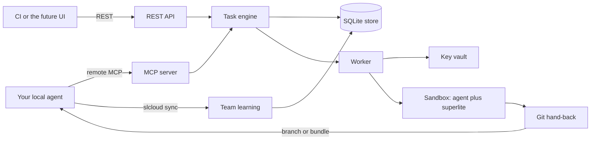
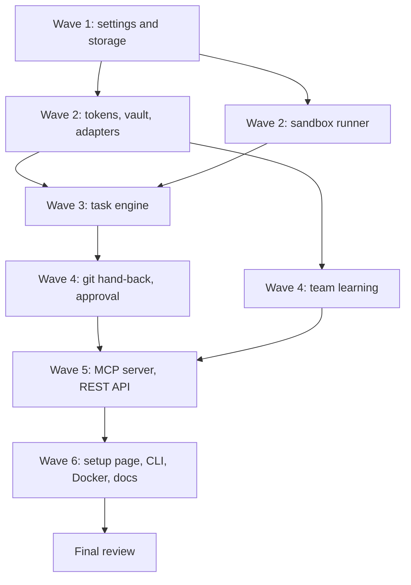

# superlite.cloud core server: review plan

## Summary
superlite.cloud is an open-source server that runs superlite builds in the cloud. A team starts it with one `docker compose up`. Each developer connects their local agent (Claude Code, Codex, Gemini CLI or Cursor) to it as a remote MCP server. A developer hands it a task. It runs superlite inside an isolated container, using the team's own model keys, and stops for plan approval exactly as superlite does locally. It then hands the result back as a git branch that you fetch into your checkout. It also collects each member's anonymised superlite learning data, so the team shares one learning loop, with a review step before any shared lesson reaches anyone. This plan builds the server only. The web UI is a separate project that will use the same API.

What you said: a new repo, written in Python, a regular build, human orchestrator, and the UI is separate. The build must keep the superlite core, run several model vendors, use the customer's own keys, and put self-hosting first.
What I assumed: version 0.1 targets a single team on a single host. Enterprise features (SSO, SCIM, audit export, licence keys) come later, in a separate `ee/` folder.

## What you will get
- `docker compose up` starts the server and a worker image. The image already has Claude Code, Codex and Cursor CLIs, the Gemini CLI and superlite installed at pinned versions. On first start it prints an admin token and the setup page's address.
- A built-in setup page, opened in the browser with the admin token:
  - **Agents:** each installed agent, with its version and superlite's, and a "check" button that runs it once.
  - **Keys:** add an API key per provider. It's tested with one tiny call, stored encrypted, and only the last 4 characters are shown again.
  - **Connect:** the one-line command for your local agent, with a copy button.
- An `slcloud` command line:
  - `slcloud key set anthropic` stores a model key.
  - `slcloud connect claude` (or `codex`, `gemini`, `cursor`) registers the server with that agent.
  - `slcloud sync` uploads your learning data.
- These tools in your local agent:
  - submit a task, check its status, list tasks
  - approve or request changes on a plan
  - cancel a task
  - get the fetch command for a result
  - read the team's lessons
- The same actions as a REST API, plus signed webhooks, for CI and for the future UI.
- Tasks run with Claude Code (with superlite loaded), Codex, Gemini or Cursor, picked per task.
- Results come back as a branch on your repo, plus a git bundle you can download when the server can't push.
- Team learning:
  - Uploaded rows are checked against superlite's allow-list. Anything else is refused.
  - Team totals per signal.
  - Proposed lessons wait in a holding area until an admin approves them.
- Tests that run without Docker or real model keys, plus one optional end-to-end Docker test.

## What will be built
| Part | What it does (one sentence) | Size | Built by |
|---|---|---|---|
| Settings and storage | Reads config from the environment and keeps workspaces, tasks, events and lessons in one SQLite file | M | a careful helper |
| Access tokens | Creates workspace tokens, stores only their hashes, and checks the bearer token on every request | S | a careful helper |
| Key vault | Encrypts each provider key at rest and hands it to a run only as an environment variable, never logged | S | a careful helper |
| Task engine | Moves tasks through queued, running, waiting for you, done, failed and cancelled, recording every step as an event | M | a careful helper |
| Sandbox runner | Runs a job in a locked-down Docker container (no host mounts, CPU and memory limits, gVisor optional), with a plain-process version for tests | M | a careful helper |
| Agent adapters | Builds the right no-terminal command for Claude (superlite loaded), Codex, Gemini and Cursor, and reads their output | M | a fast helper |
| Git hand-back | Clones the repo at the base commit, then pushes the result branch and superlite checkpoint refs or writes a bundle | M | a careful helper |
| Plan approval | Pauses a run when superlite presents its plan, shows the plan to you, and resumes the same agent session with your answer | M | a careful helper |
| MCP server | Offers the task and lesson tools over Streamable HTTP so any of the four local agents can call them | M | a careful helper |
| REST API and webhooks | The same operations over plain HTTP for CI and the UI, with signed callbacks on status changes | M | a fast helper |
| Team learning | Accepts outbox rows, keeps team totals, and runs lessons through propose, hold, approve and deliver with who-proposed-it records | M | a careful helper |
| Setup page | A plain HTML page served by the server (agents and versions, add and test keys, connect command) built on the REST API | M | a fast helper |
| Command line | `init`, `token`, `key`, `connect`, `sync`, `serve` and `worker` commands | M | a fast helper |
| Docker packaging | The server image, the worker image (pinned agent CLIs plus superlite) and the compose file | S | a fast helper |
| Docs | A README with a five-minute quick start, the licence (MIT), and a security note | S | a fast helper |

## How it fits together


## Key code changes
Each agent CLI turns into one command line run inside the sandbox, so adding a vendor means adding one adapter:

```python
class AgentAdapter(Protocol):
    name: str                      # "claude" | "codex" | "gemini" | "cursor"
    key_env: str                   # e.g. "ANTHROPIC_API_KEY"
    def command(self, prompt: str, resume: str | None) -> list[str]: ...
    def parse(self, stdout: str) -> AgentResult: ...   # text, session id, plan text if it paused

CLAUDE = ["claude", "-p", "--bare", "--plugin-dir", "/opt/superlite",
          "--output-format", "stream-json", "--permission-mode", "acceptEdits"]
```

Long builds don't hold an open connection. The MCP spec no longer lets a dropped stream resume, so a client polls a task handle instead:

```python
@mcp.tool()
def submit_task(repo: str, prompt: str, agent: str = "claude", base: str = "HEAD") -> dict:
    task = engine.submit(workspace(), repo=repo, prompt=prompt, agent=agent, base=base)
    return {"task_id": task.id, "status": task.status}          # queued

@mcp.tool()
def respond(task_id: str, answer: str) -> dict:                  # "approve" or the changes you want
    return engine.respond(workspace(), task_id, answer).public()
```

Learning rows are checked against superlite's own allow-list before anything is stored:

```python
OUTBOX_FIELDS = {"v", "date", "repo", "superlite", "signal", "id", "tool", "count", "requested", "ran", "run"}
def accept_row(row: dict) -> dict:
    extra = set(row) - OUTBOX_FIELDS
    if extra:
        raise Rejected(f"fields not allowed: {sorted(extra)}")   # never file, path, command or text
    return row
```

## How it gets built


## Decisions you can change
- Storage: SQLite file (default) | Postgres now
- Sign-in from agents: workspace bearer tokens (default) | OAuth now
- Results: push the branch to your remote, with a bundle when push fails (default) | bundle only, never push
- Container isolation: Docker with limits, gVisor available as a setting (default) | gVisor required
- Agents in 0.1: all four (default) | Claude and Codex first
- Licence: MIT core, with paid features later in a separate `ee/` folder (default) | Apache-2.0
- Plan detail: interfaces plus tests (default) | full code sketches
- Run the whole test suite at finish: no, affected tests only (default) | yes, once at finish

## Risks
- **Untrusted repos can run code.**
  - The Claude adapter always uses `--bare`, because without it a repo's hooks and MCP servers run on start.
  - The container gets no host mounts, no Docker socket and no SSH or cloud credentials, and only the one key that task needs.
- **Pausing for approval relies on the agent's resume flag.** Claude and Codex support resume. Gemini and Cursor don't, so they run in AI-orchestrator mode with a clear notice.
- **Provider terms.** Each workspace supplies its own API keys and the server never resells model use. Gemini needs an API key, not a Google sign-in. The Gemini CLI to Antigravity CLI switch is tracked as a follow-up.
- **Poisoned lessons.** Lessons are never delivered automatically. Each records who proposed it, an admin must approve it, and it can be withdrawn.
- **Secrets in logs.** Known key values are masked in stored output before it is saved.
- **No official worker image for Claude Code.** We pin the CLI versions in our own image and test it in the optional Docker test.

## Out of scope
- The full web UI (task lists, approvals, team lessons). It is a separate project that will use the REST API. Only the setup page is built here.
- Installing agents at runtime from the setup page. Agents ship in the image, and an update means pulling a newer pinned image.
- Signing in with a Claude, Cursor or Google subscription. Only API keys are accepted, because of the provider terms.
- OpenCode. Codex CLI covers OpenAI for 0.1.
- SSO, SCIM, audit export, licence keys, billing and running many customers on one hosted server.
- E2B, Firecracker and Kubernetes backends. The sandbox runner's design leaves room for them.
- Changing superlite itself. Approved team lessons are served by the server and not yet written into local lesson caches.
- A2A, OAuth, and the MCP tasks extension. Polled task tools work in every client today.

## How we will know it works
- On the setup page, a valid key shows "works" and a wrong key shows the provider's error, and neither is ever shown in full again.
- A fresh machine goes from `docker compose up` to a first task submitted from Claude Code in under five minutes, following the README.
- Every part can be tested on its own, using a fake agent and the plain-process sandbox, with no Docker or keys needed.
- A task for a human-orchestrated repo stops at "waiting for you" with the plan text. `respond approve` finishes it. `respond <changes>` gets a revised plan.
- A finished task's branch can be fetched with the printed `git fetch` command, and it holds superlite's checkpoint refs.
- `slcloud sync` uploads new outbox rows exactly once. A row with a `file` or `text` field is refused.
- A lesson proposed by one member reaches another member only after an admin approves it.
- A request without a token, or with another workspace's token, gets 401 or 404 and never sees that workspace's data.

## Rough time and cost
15 parts (4 S, 11 M). About 60 to 120 minutes and $30 to $70 (rough, until the machine plan is linted).
