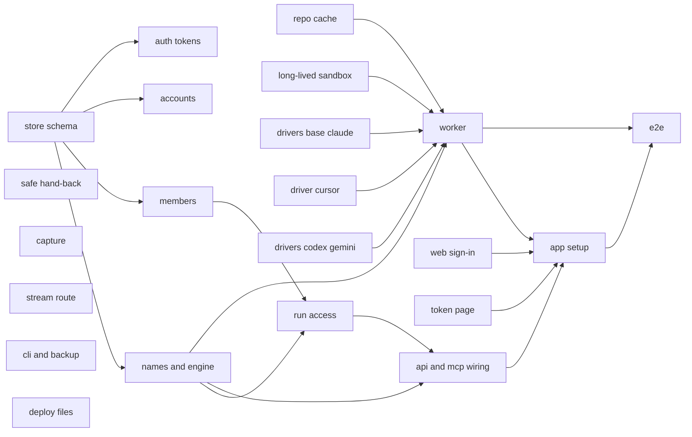

# Cloud live runs, members and sign-in

**Goal:** Runs you can watch and nudge live, owned by members, handed between members by email, with sign-in, a token page, safe hand-back and backups. superlite-cloud rows only.
**Architecture:** names + members + run access sit on the engine; the worker runs one long-lived sandbox per run from a shared repo cache, drives the agent through a driver, captures short events, and hands back through the cache; an SSE route streams events; web pages for sign-in and tokens sit behind a session cookie.
**Tech stack:** Python 3.12, FastAPI, uvicorn, mcp (FastMCP), cryptography, httpx, pytest, pyyaml (dev)
**Detail:** contracts
**Full suite:** no
**Target-min:** 8
**Ignore:** .venv/, *.db, work/
**Review plan:** docs/plans/2026-11-15-cloud-live-runs.review.md

## Global constraints

- language: python >=3.12; package slcloud in src/slcloud/; tests in tests/; test command: .venv/bin/python -m pytest -q -m "not slow"
- superlite-cloud imports superlite as a package; superlite stays stdlib-only.
- No network in fast tests. HTTP, docker and agent CLIs are injected callables or fakes. Local git on tmp_path and a local python child process are allowed.
- Secrets never appear in logs, events or API output (mask with `adapters.redact` and `vault.mask`).
- No backwards compatibility: the schema goes straight into `slcloud init`; no migrations, no FKs.
- Run name: 1-3 words of `[a-z0-9]` joined by `_`. Slug = name with `_` -> `-`. Branch = `superlite/sessions/<slug>`. Clash suffix `_2`, `_3`, ...
- Member handle `[a-z0-9-]`, unique per workspace. Email lowercase, unique server-wide. Member id `m_` + 8 hex.
- A run route that the caller may not see answers 404 `{"error": "not found"}` (NotFound), never 403.
- Examples use `pat@example.com` and `chris@example.com`.
- Until the call-site tasks land (T11, T19, T21), tests outside a task's Owns may be red; each task verifies its own test files.

## File structure

store.py schema · names.py run names · engine.py runs and nudges · auth.py tokens · members.py member rows · repocache.py shared repo cache · gitops.py safe hand-back · sandbox.py long-lived sandbox · capture.py live events · drivers/ one driver per agent · stream.py SSE and nudge routes · runs.py run access, give, notices · api.py and mcp_server.py routes · accounts.py invites, passwords, sessions · webauth.py sign-in pages · tokens_page.py token page · backup.py backup and restore · worker.py run loop · app.py and setup.py wiring · compose.yaml, Caddyfile, Dockerfile.worker deploy

## Core

### T17 store schema · Complexity 3 · Est. context 22k
**Owns:** src/slcloud/store.py, tests/test_store.py
**Components:** 1
**LOC owned:** 120
**Tests:** fast
**Model:** sonnet
**Consumes:** none
**Produces:** store.Store(path: str)
e.g. Store(str(tmp_path / "s.db")).query("SELECT name FROM sqlite_master WHERE type='table'") includes members, tokens, tasks, invites, web_sessions, sign_in_misses, notices, nudges
**Review Focus:** test_token_needs_member: inserting a token row with member NULL raises sqlite3.IntegrityError; test_task_needs_owner: a tasks row with owner NULL or name NULL raises IntegrityError; test_email_unique: two members rows with the same email raise IntegrityError, two with email NULL do not; test_handle_unique_per_workspace: same handle in two workspaces is fine, twice in one raises
**Test code (contracts):** the e.g. line and the four above
**Notes:** Schema: members(id PK, workspace, handle, email UNIQUE NULL, role, locked INTEGER DEFAULT 0, password NULL, created, UNIQUE(workspace, handle)); tokens(id PK, hash UNIQUE, workspace, role, member NOT NULL, name, created, last_used); tasks gains owner NOT NULL, name NOT NULL, dir; invites(code_hash PK, workspace, member, expires, used); web_sessions(sid_hash PK, member, expires); sign_in_misses(handle PK, count, until); notices(id AUTOINCREMENT, member, task, by_member, text, seen DEFAULT 0, at); nudges(id AUTOINCREMENT, task, sender, text, status DEFAULT 'queued', at, delivered_at). Keep query and exec.

### T1 names and engine · Complexity 5 · Est. context 28k
**Owns:** src/slcloud/names.py, src/slcloud/engine.py, tests/test_names.py, tests/test_engine.py
**Components:** 2
**LOC owned:** 240
**Tests:** fast
**Model:** sonnet
**Consumes:** store.Store(path: str) (T17)
**Produces:** names.make_name(task: str) -> str · names.check_name(name: str) -> str · names.slug(name: str) -> str · names.free_name(base: str, taken: set[str]) -> str · engine.Engine.submit(ws: str, repo: str, prompt: str, agent: str, base: str, *, owner: str, name: str | None = None) -> Task · engine.Engine.list(ws: str, owner: str | None = None) -> list[Task] · engine.Engine.events(task_id: str, after: int = 0) -> list[dict] · engine.Engine.rename(task_id: str, name: str) -> Task · engine.Engine.add_nudge(task_id: str, sender: str, text: str) -> int · engine.Engine.pending_nudges(task_id: str) -> list[dict] · engine.Engine.mark_nudge(nudge_id: int, status: str) -> None
e.g. make_name("Fix the login redirect") -> "login_fix"
e.g. make_name("Dark mode for settings page") -> "dark_mode"
e.g. check_name("a_b_c_d") raises ValueError; check_name("Login-Fix") raises ValueError; slug("login_fix") -> "login-fix"
e.g. free_name("auth", {"auth"}) -> "auth_2"; free_name("auth", {"auth", "auth_2"}) -> "auth_3"
e.g. submit("w_ab12", "https://github.com/acme/app", "Fix the login redirect", "claude", "main", owner="m_9f2c1a7e") -> Task(id="t_1", name="login_fix", owner="m_9f2c1a7e", status="queued", ...)
e.g. list("w_ab12", owner="m_9f2c1a7e") -> [Task(id="t_1", name="login_fix", owner="m_9f2c1a7e", ...)]
e.g. rename("t_1", "login_fix_3") -> Task(id="t_1", name="login_fix_3", ...)
e.g. events("t_1", after=417) -> [{"id": 418, "kind": "tool", "data": {"step": 14, "tool": "Edit", "target": "api.py"}, "at": "2026-11-15T14:20:01Z"}]
e.g. pending_nudges("t_1") -> [{"id": 3, "sender": "m_9f2c1a7e", "text": "use the v2 route", "at": "..."}]
**Review Focus:** test_run_needs_owner: submit without owner raises TypeError; test_free_name_scope: a run named login_fix live on the same repo by another member makes the next submit login_fix_2; a done run elsewhere does not; test_events_after: events(after=n) never returns ids <= n; test_nudge_order: pending_nudges returns queued nudges oldest first and skips delivered ones
**Test code (contracts):** the e.g. lines and the four above; test_name_override (submit name="Login Fix" raises ValueError, name="login_fix" kept)
**Notes:** make_name: lowercase, keep [a-z0-9] words, drop stop words (the, a, an, for, of, to, in, on, and, with, my, our); if the first word is a common verb (fix, add, remove, update, make, build, change, refactor, improve, rename, delete, support) the name is the next content word + "_" + verb; else the first two content words; empty -> "run". FIELDS gains "dir"; PUBLIC gains "name", "owner". Do not edit callers of submit; T11, T19 and T21 update them.

### T18 auth tokens · Complexity 4 · Est. context 24k
**Owns:** src/slcloud/auth.py, tests/test_auth.py, tests/test_auth_security.py
**Components:** 1
**LOC owned:** 140
**Tests:** fast
**Model:** sonnet
**Consumes:** store.Store(path: str) (T17)
**Produces:** auth.create_token(store: Store, workspace: str, role: str, member: str, name: str = "") -> str · auth.list_tokens(store: Store, member: str) -> list[dict] · auth.revoke_token(store: Store, token_id: str) -> bool
e.g. create_token(store, "w_ab12", "member", "m_9f2c1a7e", "laptop") -> "slc_..."
e.g. list_tokens(store, "m_9f2c1a7e") -> [{"id": "k_ab12cd34", "name": "laptop", "role": "member", "created": "...", "last_used": None}]
e.g. revoke_token(store, "k_ab12cd34") -> True
**Review Focus:** test_check_token_member: check_token returns Principal with member and handle, and sets last_used; test_revoke_token: revoked token -> check_token None; test_list_no_hash: list_tokens never returns the hash or the token; test_token_not_logged: create_token logs nothing that contains the token
**Test code (contracts):** the e.g. lines and the four above
**Notes:** Principal gains handle (joined from members). Keep check_token's existing signature.

### T2 members · Complexity 3 · Est. context 24k
**Owns:** src/slcloud/members.py, tests/test_members.py, src/slcloud/errors.py
**Components:** 1
**LOC owned:** 150
**Tests:** fast
**Model:** sonnet
**Consumes:** store.Store(path: str) (T17)
**Produces:** members.create_member(store: Store, workspace: str, handle: str, email: str | None, role: str) -> str · members.member_by_email(store: Store, email: str) -> dict | None · members.member_by_handle(store: Store, workspace: str, handle: str) -> dict | None · members.list_members(store: Store, workspace: str) -> list[dict] · members.rename(store: Store, member_id: str, handle: str) -> None · members.set_email(store: Store, member_id: str, email: str) -> None · members.set_role(store: Store, member_id: str, role: str) -> None · members.lock(store: Store, member_id: str) -> None
e.g. member_by_email(store, "PAT@Example.com") -> {"id": "m_1a2b3c4d", "workspace": "w_ab12", "handle": "pat", "email": "pat@example.com", "role": "member", "locked": 0}
e.g. member_by_handle(store, "w_ab12", "pat") -> {"id": "m_1a2b3c4d", "workspace": "w_ab12", "handle": "pat", "email": "pat@example.com", "role": "member", "locked": 0}
e.g. create_member(store, "w_ab12", "Pat!", None, "member") raises ValueError
e.g. list_members(store, "w_ab12") -> [{"id": "m_9f2c1a7e", "handle": "chris", "email": "chris@example.com", "role": "admin", "locked": 0}, ...]
**Review Focus:** test_email_case: create with "Pat@Example.COM" stores "pat@example.com"; test_email_unique_server_wide: same email in another workspace raises ValueError; test_lock: lock deletes the member's tokens and web_sessions, clears password, sets locked=1, keeps tasks rows; test_set_role_tokens: set_role updates the role on every token of that member
**Test code (contracts):** the e.g. lines and the four above; test_handle_unique (same handle twice in one workspace raises ValueError)

### T3 repo cache · Complexity 5 · Est. context 26k
**Owns:** src/slcloud/repocache.py, tests/test_repocache.py
**Components:** 1
**LOC owned:** 220
**Tests:** fast
**Model:** sonnet
**Consumes:** none
**Produces:** repocache.cache_for(data_dir: str, workspace: str, repo: str) -> RepoCache · repocache.RepoCache.lock() -> ContextManager · repocache.RepoCache.fetch() -> set[str] · repocache.RepoCache.light_clone(base: str, dest: str) -> None · repocache.RepoCache.fetch_from(src: str, branch: str, into: str) -> str · repocache.RepoCache.push(ref: str, branch: str) -> bool · repocache.RepoCache.bundle(ref: str, out: str) -> str · repocache.RepoCache.drop_ref(ref: str) -> None · repocache.cleanup(data_dir: str, in_use: set[str], now: float, idle_days: int = 14) -> list[str]
e.g. cache_for("/data", "w_ab12", "https://github.com/acme/app").path -> "/data/repos/w_ab12/<sha256(repo)[:16]>.git"
e.g. fetch() -> {"main", "superlite/sessions/login-fix"}
e.g. fetch_from("/work/t_1", "superlite/sessions/login-fix", "refs/runs/t_1") -> "3f9e2c1..." (40-hex sha)
e.g. cleanup("/data", {"/data/repos/w_ab12/1a2b3c4d5e6f7a8b.git"}, now) -> ["/data/repos/w_ab12/9f8e7d6c5b4a3f2e.git"]
**Review Focus:** test_planted_hook_not_run: run dir with .git/hooks/post-receive and core.fsmonitor set to a script that writes a file; fetch_from runs, the file never appears; test_no_working_files: cache is bare; test_light_clone_shared: dest/.git/objects/info/alternates points at the cache; test_cleanup_idle: a cache untouched 15 days and not in in_use is removed, one in in_use is kept; test_lock_exclusive: a second lock() in another thread waits
**Test code (contracts):** the five above, using a local origin repo made in tmp_path; test_push_refused (push of a non-fast-forward returns False)
**Notes:** fetch = `git fetch --prune origin +refs/heads/*:refs/heads/*` and returns the branch names. fetch_from runs `git -c core.hooksPath=/dev/null -c core.fsmonitor= fetch <src> +refs/heads/<branch>:<into>` from the cache, never git in src. Lock is fcntl on `<path>.lock`. light_clone = `git clone --shared --no-checkout` then checkout base.

### T4 safe hand-back · Complexity 5 · Est. context 25k
**Owns:** src/slcloud/gitops.py, tests/test_gitops.py
**Components:** 1
**LOC owned:** 150
**Tests:** fast
**Model:** sonnet
**Consumes:** repocache.RepoCache.fetch() -> set[str] (T3) · names.free_name(base: str, taken: set[str]) -> str (T1)
**Produces:** gitops.safe_hand_back(cache: RepoCache, run_dir: str, name: str, task_id: str, own: set[str], rename: Callable[[str, str], None], commit: Callable[[], None], log: Callable[[str], None], bundle_dir: str) -> HandBack
e.g. branch free -> HandBack(branch="superlite/sessions/login-fix", sha="3f9e...", pushed=True, bundle=None, fetch="git fetch origin superlite/sessions/login-fix")
e.g. branch taken by another -> rename("login_fix", "login_fix_3") called, log("renamed login_fix to login_fix_3: branch taken on origin"), branch superlite/sessions/login-fix-3
**Review Focus:** test_own_branch_not_clash: branch in fetch() and in own -> no rename; test_push_race: first push False and branch now taken -> rename once, second push True; test_bundle_fallback: both pushes False -> bundle path set, pushed False; test_ref_dropped: drop_ref("refs/runs/t_1") called even when fetch_from raises
**Test code (contracts):** the e.g. lines and the four above with a fake RepoCache
**Notes:** order: under cache.lock(): fetch, rename on clash; commit(); fetch_from(run_dir, branch, into=f"refs/runs/{task_id}"); push; on refusal fetch + rename + retry once; else bundle. drop_ref in finally. Taken names come from branches under superlite/sessions/ mapped back with `-` -> `_`. Keep clone_at and hand_back.

### T5 long-lived sandbox · Complexity 5 · Est. context 26k
**Owns:** src/slcloud/sandbox.py, tests/test_sandbox.py
**Components:** 1
**LOC owned:** 200
**Tests:** fast
**Model:** sonnet
**Consumes:** none
**Produces:** sandbox.Mount(host: str, path: str, read_only: bool = True) · sandbox.ProcessRunner.start(job: Job, popen) -> Proc · sandbox.DockerRunner.start(job: Job) -> Proc · sandbox.Proc.write(text: str) -> None · sandbox.Proc.lines() -> Iterator[str] · sandbox.Proc.close_stdin() -> None · sandbox.Proc.wait() -> JobResult · sandbox.Proc.kill() -> None
e.g. DockerRunner().argv(Job(..., mounts=[Mount("/data/repos/w/x.git", "/data/repos/w/x.git")])) contains "-v", "/data/repos/w/x.git:/data/repos/w/x.git:ro"
e.g. ProcessRunner().start(Job(command=["python", "-c", "import sys;[print(l.upper(),end='') for l in sys.stdin]"], ...)); write("hi\n"); close_stdin(); list(lines()) -> ["HI"]; wait().code -> 0
e.g. start(Job(command=["claude", "-p"], ...)) -> Proc (stdin open, stdout line-buffered)
e.g. lines() -> iter(['{"type":"assistant",...}', '{"type":"result",...}']) (one item per stdout line, newline stripped)
e.g. wait() -> JobResult(code=0, timed_out=False, ...)
**Review Focus:** test_start_stdin_open: DockerRunner.start argv has "-i" after "run"; test_timeout_kills: a job with timeout_s=1 running sleep 5 gives wait().timed_out True and docker rm -f called; test_mount_validation: a mount path with ":" or "," raises ValueError; test_env_not_in_argv: key values never appear in argv
**Test code (contracts):** the e.g. lines and the four above; DockerRunner tests use a fake popen
**Notes:** Job gains `mounts: list[Mount] = field(default_factory=list)`. DockerRunner takes `popen=subprocess.Popen`. Keep run() working.

### T6 capture · Complexity 3 · Est. context 23k
**Owns:** src/slcloud/capture.py, tests/test_capture.py
**Components:** 1
**LOC owned:** 120
**Tests:** fast
**Model:** sonnet
**Consumes:** none
**Produces:** capture.Capture(task_id: str, add_event: Callable[[str, str, dict], None], secrets: list[str], clock: Callable[[], float], min_gap: float = 0.25) · capture.Capture.feed(event: dict) -> None · capture.Capture.flush() -> None
e.g. feed({"kind": "tool", "tool": "Edit", "target": "api.py"}) -> add_event("t_1", "tool", {"step": 1, "tool": "Edit", "target": "api.py"})
e.g. feed({"kind": "text", "text": "using sk-abcdefghijklmnop1234 now"}) -> data {"step": n, "text": "using [redacted] now"}
**Review Focus:** test_fake_key_masked: a vault secret "zzsecretvalue123" inside text is masked; test_throttle: three text events 0.1 s apart give one event, the last text kept, flushed on flush(); test_truncate: 500-char text is cut to 200; test_status_never_throttled: kind status and file always emit
**Test code (contracts):** the e.g. lines and the four above
**Notes:** kinds: text, tool, file, status. Only text is throttled.

### T7 drivers base claude · Complexity 5 · Est. context 27k
**Owns:** src/slcloud/drivers/__init__.py, src/slcloud/drivers/base.py, src/slcloud/drivers/claude.py, tests/test_drivers.py
**Components:** 2
**LOC owned:** 200
**Tests:** fast
**Model:** sonnet
**Consumes:** sandbox.Proc.write(text: str) -> None (T5) · sandbox.Proc.lines() -> Iterator[str] (T5)
**Produces:** drivers.get_driver(agent: str, start: Callable[[list[str]], Proc], session: str | None = None) -> Driver · drivers.base.Driver.start(prompt: str) -> None · drivers.base.Driver.lines() -> Iterator[str] · drivers.base.Driver.nudge(text: str) -> str · drivers.base.Driver.stop() -> None · drivers.base.Driver.events(line: str) -> list[dict] · drivers.base.Driver.result() -> AgentResult
e.g. get_driver("claude", start) -> ClaudeDriver(session=None); get_driver("cursor", start, session="c_1") -> CursorDriver(session="c_1")
e.g. nudge("use v2") on claude writes '{"type":"user","message":{"role":"user","content":"use v2"}}\n' to stdin and returns "delivered"
e.g. events('{"type":"assistant","message":{"content":[{"type":"tool_use","name":"Edit","input":{"file_path":"api.py"}}]}}') -> [{"kind": "tool", "tool": "Edit", "target": "api.py"}]
e.g. result() -> AgentResult(text="done", plan=None, session="s_1", ...)
e.g. lines() -> iter(['{"type":"assistant",...}'])
**Review Focus:** test_claude_stream_json: start argv has --input-format stream-json --output-format stream-json and the key is not in argv; test_unknown_agent: get_driver("x", ...) raises ValueError; test_result_plan: a result with PLAN_MARKER gives AgentResult.plan set; test_nudge_after_stop: nudge after stop() returns "unsupported" without writing
**Test code (contracts):** the e.g. lines and the four above with a fake Proc
**Notes:** Driver also has `session: str | None`. cursor, gemini and codex names map to T20 and T8 classes, imported lazily inside get_driver.

### T20 driver cursor · Complexity 4 · Est. context 23k
**Owns:** src/slcloud/drivers/cursor.py, tests/test_drivers_cursor.py
**Components:** 1
**LOC owned:** 110
**Tests:** fast
**Model:** sonnet
**Consumes:** drivers.base.Driver.start(prompt: str) -> None (T7) · sandbox.Proc.lines() -> Iterator[str] (T5)
**Produces:** cursor.CursorDriver(start: Callable[[list[str]], Proc], session: str | None = None)
e.g. CursorDriver(start).nudge("use v2") -> "queued"; after the turn ends it restarts with `--resume <chat id>` and the queued text
**Review Focus:** test_cursor_same_chat: resume uses the chat id from the first turn; test_queued_in_order: two nudges in one turn are sent in order on the next turn; test_key_not_in_argv: the API key never appears in argv
**Test code (contracts):** the e.g. line and the three above with a fake Proc
**Notes:** Subclass drivers.base.Driver. If base.py is still a stub, write against the T7 Produces signatures.

### T8 drivers codex gemini · Complexity 6 · Est. context 29k
**Owns:** src/slcloud/drivers/codex.py, src/slcloud/drivers/gemini.py, tests/test_drivers_rpc.py
**Components:** 2
**LOC owned:** 260
**Tests:** fast
**Model:** sonnet
**Consumes:** drivers.base.Driver.start(prompt: str) -> None (T7) · sandbox.Proc.lines() -> Iterator[str] (T5)
**Produces:** codex.CodexDriver(start: Callable[[list[str]], Proc], session: str | None = None) · gemini.GeminiDriver(start: Callable[[list[str]], Proc], session: str | None = None)
e.g. CodexDriver nudge("use v2") sends {"jsonrpc":"2.0","id":N,"method":"turn/steer","params":{"threadId":"th_1","input":[{"type":"text","text":"use v2"}]}} -> "delivered"
e.g. GeminiDriver nudge("use v2") sends session/cancel then session/prompt with the same sessionId -> "delivered"
**Review Focus:** test_codex_handshake: initialize, thread/start, turn/start in that order; test_gemini_handshake: initialize, session/new, session/prompt; test_rpc_error_watch_only: a JSON-RPC error on turn/steer returns "unsupported"; test_bad_json_line_skipped: a non-JSON line yields no event and no crash
**Test code (contracts):** the e.g. lines and the four above with a fake Proc
**Notes:** codex app-server 0.169.0, gemini ACP 0.68.0 (`gemini --experimental-acp`). Subclass drivers.base.Driver; if base.py is still a stub, write against the T7 Produces signatures.

## Interfaces

### T9 stream route · Complexity 5 · Est. context 27k
**Owns:** src/slcloud/stream.py, tests/test_stream.py
**Components:** 1
**LOC owned:** 160
**Tests:** fast
**Model:** sonnet
**Consumes:** engine.Engine.events(task_id: str, after: int = 0) -> list[dict] (T1) · engine.Engine.add_nudge(task_id: str, sender: str, text: str) -> int (T1) · runs.get_run(store: Store, who: Principal, ref: str) -> Task (T10)
**Produces:** stream.sse_lines(engine: Engine, task_id: str, after: int, alive: Callable[[], bool], sleep: Callable[[float], None], keepalive_s: float, clock: Callable[[], float], run: str | None = None) -> Iterator[str] · stream.make_router(store: Store, engine: Engine, whoami: Callable) -> APIRouter
e.g. sse_lines(...) first item "id: 418\nevent: tool\ndata: {\"run\":\"login_fix\",\"step\":14,\"tool\":\"Edit\",\"target\":\"api.py\"}\n\n"
e.g. no events for 15 s -> ": keep-alive\n\n"
**Review Focus:** test_replay_after_last_event_id: Last-Event-ID 417 gives 418 onward and nothing before; test_stream_ends_when_hidden: alive() False ends the generator; test_nudge_route: POST /api/runs/{ref}/nudge {"text": "x"} -> 202 {"id": 3, "status": "queued"} and add_nudge got sender=caller member; test_non_owner_404: get_run raising NotFound gives 404 on both routes
**Test code (contracts):** the e.g. lines and the four above with a fake engine and get_run

### T10 run access · Complexity 5 · Est. context 26k
**Owns:** src/slcloud/runs.py, tests/test_runs.py
**Components:** 1
**LOC owned:** 180
**Tests:** fast
**Model:** sonnet
**Consumes:** engine.Engine.list(ws: str, owner: str | None = None) -> list[Task] (T1) · members.member_by_email(store: Store, email: str) -> dict | None (T2) · names.free_name(base: str, taken: set[str]) -> str (T1)
**Produces:** runs.get_run(store: Store, who: Principal, ref: str) -> Task · runs.give(store: Store, engine: Engine, who: Principal, ref: str, email: str) -> Task · runs.notices(store: Store, member: str) -> list[dict] · runs.mark_seen(store: Store, member: str) -> None
e.g. get_run(store, chris, "login_fix") -> Task(name="login_fix", owner="m_9f2c1a7e", ...); get_run(store, admin, "chris/login_fix") -> same task
e.g. give(store, eng, chris, "login_fix", "PAT@example.com") -> Task(owner="m_1a2b3c4d", name="login_fix_2") when pat already has login_fix
e.g. notices(store, "m_1a2b3c4d") -> [{"id": 1, "task": "t_1", "text": "given by chris to pat (pat@example.com)", "seen": 0}]
**Review Focus:** test_get_run_non_owner: a non-owner non-admin gets NotFound, an admin gets the task, an unknown ref gets NotFound; test_give_refusals: a handle, an unknown email, a locked member's email, another workspace's email -> NoSuchMember; test_give_one_transaction: owner, event log, notice and rename commit together, a failure leaves all unchanged; test_mark_seen: notices after mark_seen all have seen 1
**Test code (contracts):** the e.g. lines and the four above; members is a fake returning the T2 e.g. rows; real Store and Engine on tmp_path
**Notes:** NoSuchMember is a new error in runs.py (404 {"error": "no such member"}). The giver's stream ends because get_run then fails.

### T19 api and mcp wiring · Complexity 5 · Est. context 28k
**Owns:** src/slcloud/api.py, src/slcloud/mcp_server.py, tests/test_api.py, tests/test_mcp.py
**Components:** 2
**LOC owned:** 200
**Tests:** fast
**Model:** sonnet
**Consumes:** runs.get_run(store: Store, who: Principal, ref: str) -> Task (T10) · runs.give(store: Store, engine: Engine, who: Principal, ref: str, email: str) -> Task (T10) · runs.notices(store: Store, member: str) -> list[dict] (T10) · engine.Engine.submit(ws: str, repo: str, prompt: str, agent: str, base: str, *, owner: str, name: str | None = None) -> Task (T1)
**Produces:** none
**Review Focus:** test_every_route_non_owner_404: list, get, events, respond, cancel, bundle, give, attach list as a non-owner non-admin -> 404; test_body_owner_ignored: POST /api/tasks with body {"owner": "m_other"} stores owner = caller's member; test_all_admin_only: GET /api/tasks?all=1 as member -> 403; test_status_marks: GET /api/status returns notices, then a run list marks them seen
**Test code (contracts):** the four above; runs faked from the T10 e.g. lines where a real one is not needed
**Notes:** submit passes owner=who.member. Every run route goes through runs.get_run. MCP tools list_runs, give_run, status use the same functions.

### T11 cli and backup · Complexity 4 · Est. context 27k
**Owns:** src/slcloud/cli.py, src/slcloud/backup.py, tests/test_cli.py, tests/test_cli_security.py, tests/test_backup.py
**Components:** 2
**LOC owned:** 240
**Tests:** fast
**Model:** sonnet
**Consumes:** app.init_workspace(settings: Settings, name: str, member: str | None = None) -> tuple[str, str] (T21) · members.create_member(store: Store, workspace: str, handle: str, email: str | None, role: str) -> str (T2) · accounts.create_invite(store: Store, member_id: str, now: float) -> str (T12) · auth.create_token(store: Store, workspace: str, role: str, member: str, name: str = "") -> str (T18)
**Produces:** backup.backup(db_path: str, out: str) -> None · backup.restore(db_path: str, src: str, server_running: Callable[[], bool]) -> None
e.g. `slcloud init --member chris` prints "token: slc_..." and "invite: <code>"
e.g. `slcloud member list` prints "chris  chris@example.com  admin" per line
**Review Focus:** test_token_existing_other_role: `token create w admin --member chris` when chris is member -> exit 2 "chris is member, not admin"; test_token_new_needs_email: new handle without --email -> exit 2; test_backup_mode: backup file mode 0600; test_restore_refuses_running: server_running True -> exit 2, db unchanged
**Test code (contracts):** the e.g. lines and the four above; app, members, accounts and auth faked by monkeypatch
**Notes:** commands: init [name] --member H; token create <ws> <role> --member H [--email E]; member list|rename H NEW|email H E|role H R; invite H [--email E]; backup FILE; restore FILE. backup uses sqlite3 Connection.backup.

### T12 accounts · Complexity 6 · Est. context 29k
**Owns:** src/slcloud/accounts.py, tests/test_accounts.py
**Components:** 2
**LOC owned:** 220
**Tests:** fast
**Model:** sonnet
**Consumes:** store.Store(path: str) (T17)
**Produces:** accounts.create_invite(store: Store, member_id: str, now: float) -> str · accounts.redeem(store: Store, code: str, password: str, now: float) -> str · accounts.invite_info(store: Store, code: str, now: float) -> dict | None · accounts.hash_password(pw: str) -> str · accounts.sign_in(store: Store, handle: str, password: str, now: float) -> str | None · accounts.session_member(store: Store, sid: str, now: float) -> str | None · accounts.sign_out(store: Store, sid: str) -> None · accounts.origin_ok(origin: str | None, public_url: str) -> bool · accounts.check_public_url(url: str, host: str) -> str | None
e.g. invite_info(store, code, now) -> {"handle": "pat", "email": "pat@example.com"}
e.g. hash_password("correct horse battery") -> "scrypt$15$8$1$<32 hex>$<128 hex>"
e.g. sign_in(store, "pat", "correct horse battery", now) -> "Xq3...43 chars" (the sid); sign_in(store, "pat", "wrong", now) -> None
e.g. session_member(store, sid, now) -> "m_1a2b3c4d"; session_member(store, sid, now + 12 * 3600 + 1) -> None
e.g. check_public_url("http://localhost:8787", "127.0.0.1:8787") -> "Open http://localhost:8787 instead"; check_public_url("http://example.com", "example.com") -> "refused: plain http"
**Review Focus:** test_five_miss_wait_survives_restart: 5 bad passwords, new Store on the same file, the right password -> None until 15 min pass; test_same_message_and_dummy: unknown handle, locked member and wrong password all call verify once (DUMMY_HASH for unknown) and return None; test_invite_single_use_7_days: second redeem fails, redeem at 7 days + 1 s fails; test_short_password: 11 chars raises ValueError; test_sid_hash_only: web_sessions holds sha256(sid), never sid
**Test code (contracts):** the e.g. lines and the five above
**Notes:** scrypt n=2**15, r=8, p=1, maxmem=2**26, 16-byte salt, 64-byte key. sid = secrets.token_urlsafe(32), 12 h. A right password outside the wait clears the count. redeem sets password, locked=0, returns the member id.

### T13 web sign-in · Complexity 5 · Est. context 27k
**Owns:** src/slcloud/webauth.py, tests/test_webauth.py
**Components:** 1
**LOC owned:** 180
**Tests:** fast
**Model:** sonnet
**Consumes:** accounts.sign_in(store: Store, handle: str, password: str, now: float) -> str | None (T12) · accounts.session_member(store: Store, sid: str, now: float) -> str | None (T12) · accounts.origin_ok(origin: str | None, public_url: str) -> bool (T12)
**Produces:** webauth.make_router(store: Store, settings: Settings, accounts) -> APIRouter · webauth.session_principal(store: Store, settings: Settings, accounts) -> Callable[[Request], Principal | None]
e.g. POST /signin ok -> 303 to /tokens with Set-Cookie "sid=...; HttpOnly; SameSite=Strict; Max-Age=43200" (+ Secure on https)
e.g. make_router(store, settings) -> APIRouter with GET/POST /signin, GET/POST /register, POST /signout
e.g. session_principal(store, settings)(request) -> Principal(workspace="w_ab12", role="member", member="m_1a2b3c4d", handle="pat") or None
**Review Focus:** test_cookie_flags: flags above, Secure only when SLCLOUD_URL is https; test_origin_mismatch: POST /signin with Origin https://evil.example -> 403; test_register_shows_handle_email: GET /register?code=X shows pat and pat@example.com; test_no_cookie_none: session_principal with no sid returns None without calling accounts; test_signout_clears: POST /signout deletes the session and the cookie
**Test code (contracts):** the five above with a fake accounts

### T14 token page · Complexity 5 · Est. context 28k
**Owns:** src/slcloud/tokens_page.py, tests/test_tokens_page.py
**Components:** 1
**LOC owned:** 220
**Tests:** fast
**Model:** sonnet
**Consumes:** auth.create_token(store: Store, workspace: str, role: str, member: str, name: str = "") -> str (T18) · auth.list_tokens(store: Store, member: str) -> list[dict] (T18) · members.lock(store: Store, member_id: str) -> None (T2) · accounts.create_invite(store: Store, member_id: str, now: float) -> str (T12)
**Produces:** tokens_page.make_router(store: Store, settings: Settings, who: Callable, auth, members, accounts) -> APIRouter
e.g. POST /tokens {"name": "laptop"} -> page with "SUPERLITE_CLOUD_URL=https://cloud.example.com" and "SUPERLITE_CLOUD_TOKEN=slc_..." shown once
e.g. make_router(store, settings, who) -> APIRouter with GET/POST /tokens, POST /tokens/{id}/revoke, GET /members, POST /members/{id}/lock, POST /invites
**Review Focus:** test_token_shown_once: the list page after creation never shows the token; test_admin_only_actions: invite, member list, revoke-other, lock as member -> 403; test_lock_keeps_runs: lock calls members.lock and tasks are untouched; test_page_escapes: a token name "<script>" is escaped; test_shows_email
**Test code (contracts):** the five above with fakes returning the T18, T2, T12 e.g. values

## Delivery

### T15 deploy files · Complexity 2 · Est. context 21k
**Owns:** compose.yaml, Caddyfile, Dockerfile.worker, tests/test_deploy.py
**Components:** 2
**LOC owned:** 100
**Tests:** fast
**Kind:** mechanical
**Model:** haiku
**Consumes:** none
**Produces:** none
**Review Focus:** test_port_local: compose ports for the server are "127.0.0.1:8787:8787"; test_caddy_profile: a caddy service with profiles ["https"] and SLCLOUD_DOMAIN; test_cursor_pin: Dockerfile.worker has ARG CURSOR_VERSION=2026.11.13-eacade1 and no cursor.com/install; test_superlite_branch: ARG SUPERLITE_VERSION=superlite/sessions/cloud-live-runs; test_caddy_validate (marked slow, skipped without caddy)
**Test code (contracts):** the five above, parsing compose.yaml with pyyaml
**Notes:** Cursor install: curl `https://downloads.cursor.com/lab/${CURSOR_VERSION}/linux/${ARCH}/agent-cli-package.tar.gz` (ARCH x64 or arm64 from dpkg), extract to /root/.local/share/cursor-agent/versions/${CURSOR_VERSION}, symlink /root/.local/bin/agent and /root/.local/bin/cursor-agent. Caddyfile: `{$SLCLOUD_DOMAIN} { reverse_proxy server:8787 }`.

### T16 worker · Complexity 6 · Est. context 34k
**Owns:** src/slcloud/worker.py, tests/test_worker.py
**Components:** 1
**LOC owned:** 200
**Tests:** slow
**Model:** sonnet
**Consumes:** repocache.cache_for(data_dir: str, workspace: str, repo: str) -> RepoCache (T3) · repocache.cleanup(data_dir: str, in_use: set[str], now: float, idle_days: int = 14) -> list[str] (T3) · sandbox.DockerRunner.start(job: Job) -> Proc (T5) · capture.Capture.feed(event: dict) -> None (T6) · drivers.get_driver(agent: str, start: Callable[[list[str]], Proc], session: str | None = None) -> Driver (T7) · engine.Engine.pending_nudges(task_id: str) -> list[dict] (T1) · engine.Engine.mark_nudge(nudge_id: int, status: str) -> None (T1)
**Produces:** worker.run_task(task: Task, deps: Deps) -> Task
e.g. run_task(task, deps) -> Task(id="t_1", status="done", name="login_fix", ...) with event "handed back on superlite/sessions/login-fix"
**Review Focus:** test_waiting_keeps_checkout: a run that ends waiting keeps work/<id> and resumes in the same session; test_two_runs_one_repo: two runs on one repo both reach done and both branches exist on origin; test_nudge_delivered: a queued nudge is sent within 0.5 s and marked delivered, event "nudge from chris"; test_driver_fail_watch_only: a driver whose nudge raises gives event "nudges are off" and the run still finishes; test_no_git_in_run_dir: the worker never calls git with cwd = run dir
**Test code (contracts):** the five above; real git on tmp_path, ProcessRunner with a fake agent script
**Notes:** hand-back calls gitops.safe_hand_back (T4, done; read its signature and HandBack fields in src/slcloud/gitops.py). in-sandbox session: `bash /opt/superlite/skills/swarm/scripts/superlite-cli session create --slug <slug> --base <base> --branch-name superlite`; rename callable runs `superlite-cli session rename --slug <old> --to <new>` in the sandbox; commit callable runs the final commit in the sandbox. Mount the cache read-only at its own path. Poll nudges every 0.5 s. Cleanup in_use = caches of runs not done, failed or cancelled.

### T21 app setup · Complexity 5 · Est. context 30k
**Owns:** src/slcloud/app.py, src/slcloud/setup.py, tests/test_setup.py, tests/test_packaging.py, tests/test_probe_glue.py, .env.example
**Components:** 2
**LOC owned:** 160
**Tests:** fast
**Model:** sonnet
**Consumes:** worker.run_task(task: Task, deps: Deps) -> Task (T16) · webauth.make_router(store: Store, settings: Settings, accounts) -> APIRouter (T13) · webauth.session_principal(store: Store, settings: Settings, accounts) -> Callable[[Request], Principal | None] (T13) · tokens_page.make_router(store: Store, settings: Settings, who: Callable, auth, members, accounts) -> APIRouter (T14)
**Produces:** app.init_workspace(settings: Settings, name: str, member: str | None = None) -> tuple[str, str]
e.g. init_workspace(settings, "acme", member="chris") -> ("slc_...", "<invite code>")
**Review Focus:** test_init_workspace_admin: members row role admin, handle "<name>-admin" or the member value; a taken handle raises HandleTaken; test_setup_behind_signin: GET /setup with no sid -> 303 /signin; test_master_key_notice: server start logs "master key is not in backups"; test_compose_services: server ports "127.0.0.1:8787:8787" (T15)
**Test code (contracts):** the four above
**Notes:** api.create_app already mounts stream.make_router (T19); do not mount it twice. Mount the webauth and tokens_page routers beside api. Update app.py callers to auth.create_token(store, ws, role, member, name) (T18). probe_server inserts a probe member row and owns its runs. init_workspace creates the admin member, its token and an invite. .env.example gains SLCLOUD_DOMAIN (empty) with a comment that it is used only by the https profile.

**Probe entry:** call=slcloud.names.make_name · run=python -m slcloud · serve=slcloud.app.probe_server

### T22 e2e · Complexity 4 · Est. context 26k
**Owns:** tests/test_e2e.py
**Components:** 1
**LOC owned:** 120
**Tests:** slow
**Model:** sonnet
**Consumes:** app.init_workspace(settings: Settings, name: str, member: str | None = None) -> tuple[str, str] (T21) · worker.run_task(task: Task, deps: Deps) -> Task (T16)
**Produces:** none (tests only)
e.g. a run submitted over HTTP with a member token streams events, takes a nudge, and reaches done
**Review Focus:** test_e2e_watch_and_nudge: submit, stream events, nudge, run reaches done; test_mcp_over_http: MCP tools/call works with the member token; test_e2e_non_owner_404: a second member's token gets 404 on the first member's run
**Test code (contracts):** the three above with ProcessRunner and a fake agent script
**Notes:** update existing e2e tests to the owner, member and token changes (T1, T18); no real provider calls.

## Review Focus

- library (names, members, repocache, capture, drivers): deep, encoding, state. Risks: name with unicode or only stop words; a planted git hook or fsmonitor in the run dir; a secret split across two text events.
- HTTP service (api, stream, runs): protocol, encoding, state. Risks: a non-owner learning a run exists; replay gaps after Last-Event-ID; a give racing a second give.
- auth (accounts, webauth, tokens_page, auth): protocol, state; security review required. Risks: timing gaps between unknown and wrong-password; Origin missing; sid or token in logs; a locked member still signed in.
- CLI (cli, backup): protocol, file. Risks: backup readable by others; restore over a live server.
- file/process (sandbox, worker, gitops): file, state. Risks: stdin left open after the timeout; the cache removed under a waiting run; a refs/runs/ ref left behind.

## Self-review

Spec coverage: Summary (T1, T16), What you will get (T9, T10, T13, T14, T19), How a run uses sessions (T1, T3, T4, T16), Who owns a run (T1, T2, T10, T17), Signing in and making tokens (T12, T13, T14, T18), When the server or its image goes down (T11, T15, T21), What will be built (T1-T21), Which repo gets what (T15), How it fits together (T16, T21), Key code changes (T1, T4, T5, T7, T8, T20), How it gets built (T15), Decisions you can change (T15), Risks (T3, T4, T12), Out of scope (none built), How we will know it works (T1-T21), Rough time and cost (all).
