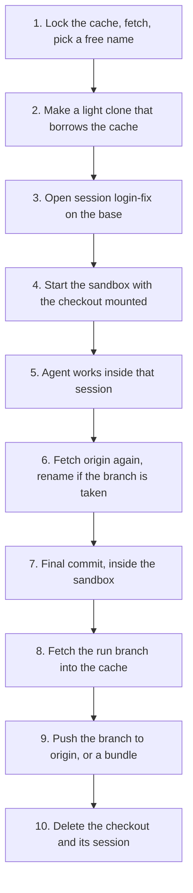
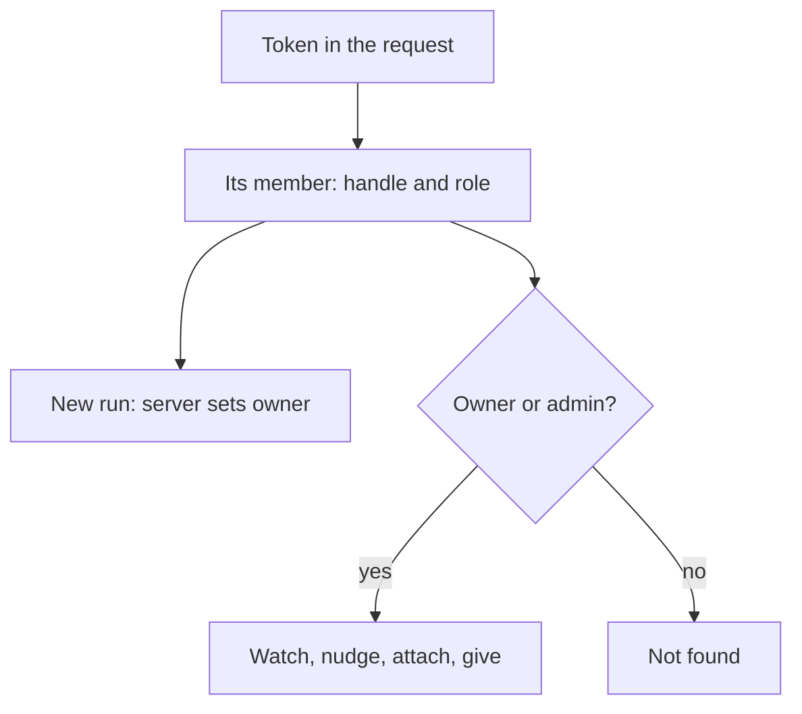
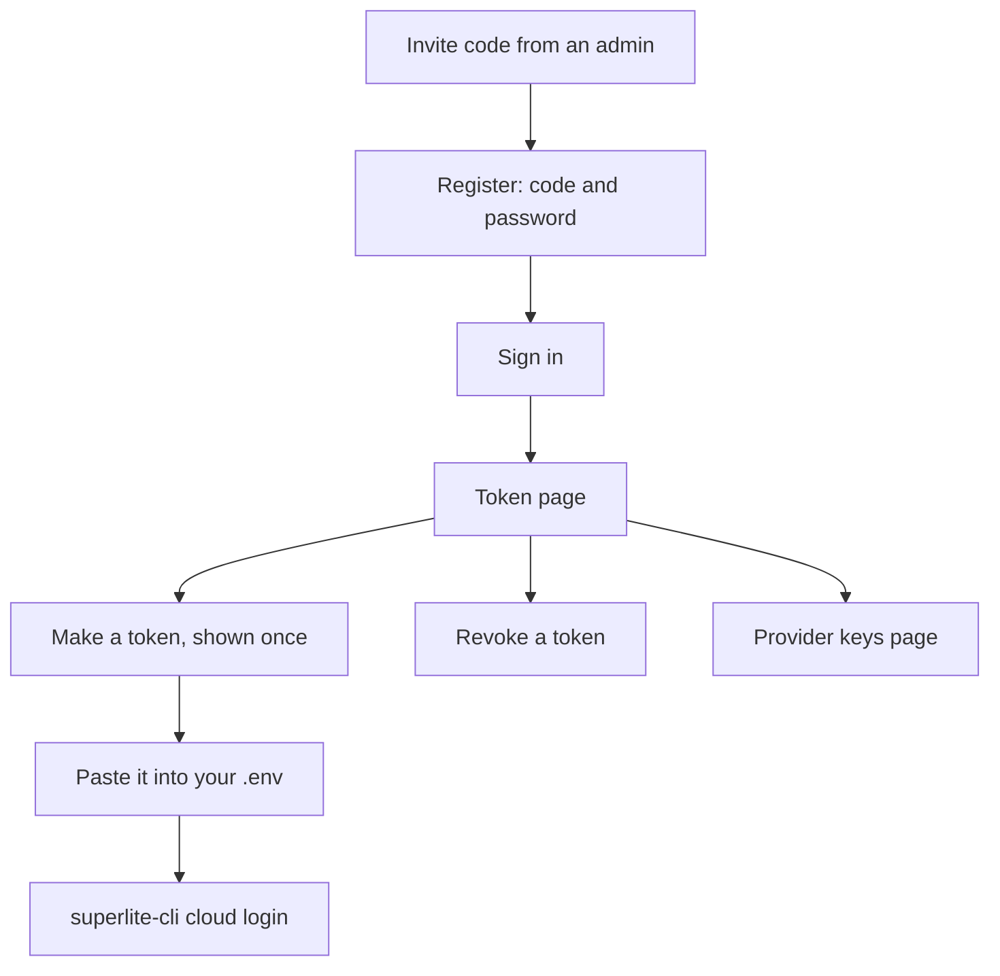
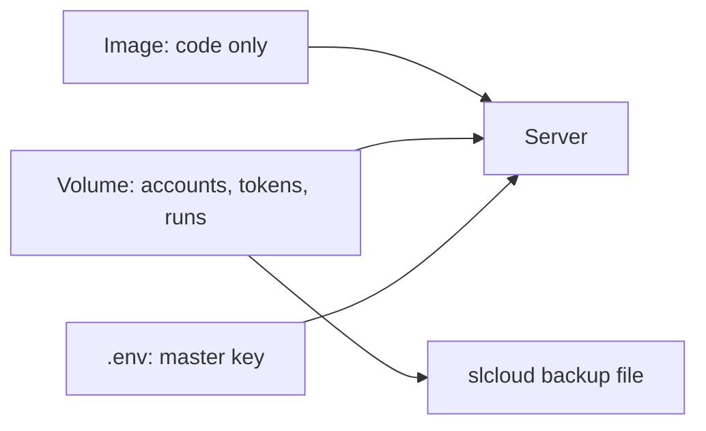
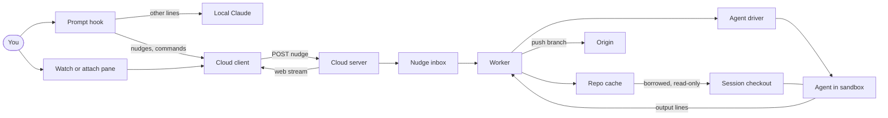
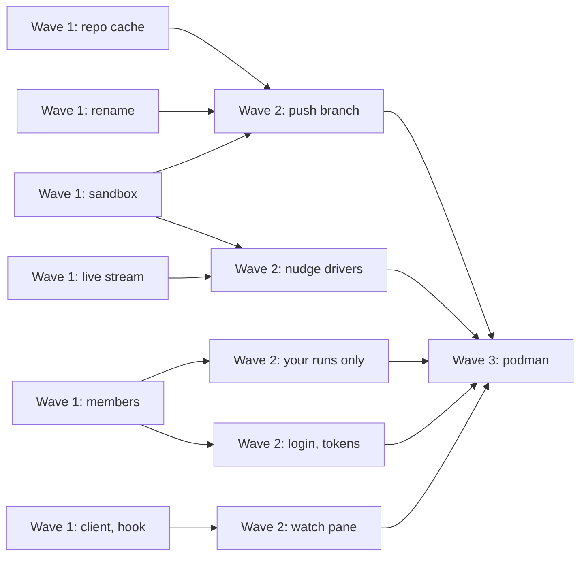

# Live cloud runs: review plan

## Summary
You can watch and steer cloud runs from your own machine as if they were local, and your local Claude pays nothing for it. The cloud streams each run's agent output live over a plain web stream. A few superlite commands list your runs, open a live view beside Claude, and send messages ("nudges") straight to the agent while it works. A small hook in your Claude session catches these commands and nudges and sends them to the cloud before Claude sees them, so they use no local tokens. This works for all four agents: Claude, Codex, Gemini and Cursor.

Runs also change how they start. Today every run downloads a full copy of the repo. Now the cloud keeps one cached copy per repo, and each run is a superlite session that borrows that cache's history. Nothing is downloaded or copied again, only the run's files are written. The run's branch is still pushed to origin when it ends, with the bundle as the fallback, and each run still runs in its own sandbox.

The work touches both repos, each in its own PR. "Which repo gets what" below lists exactly what goes where.

## What you will get
- Every run has a short name, which you use everywhere in place of an id. It is made from your task text when the run starts, for example "Fix the login redirect" becomes `login_fix`. The name is 1 or 2 words where possible and never more than 3, lowercase and joined by `_`. Making it calls no model. Pass `--name` to choose your own name. A name must be free in three places: among your own runs, among the live runs on the same repo, and among the branches on origin. A taken name gets a number added, like `login_fix_2`. In an admin's `--all` list, other people's runs show as `owner/name`.
- **One name for the run, its session and its branch.** The run `login_fix` is the superlite session `login-fix` on the branch `superlite/sessions/login-fix`. Superlite session names use `-`, so the `_` becomes `-`, and that is the only difference. If the run is renamed, its session and branch are renamed with it, so the three always match. The agent's own superlite sees it is already in that session and works in it. It never opens a second one.
- A run on a repo the cloud has seen before starts in seconds: it fetches only the new commits, then writes the files. The first run on a repo makes the cache.
- When a run ends, its branch is pushed to origin, as today. If the push fails, you get a bundle, as today.
- **The server watches origin's branches.** Every fetch of the repo cache also brings origin's current branch list. A fetch happens at each run's start on that repo and again just before each push. If a fetch shows that someone has pushed a branch with a live run's name since it started, that run is renamed at once to the next free name, for example `login_fix_3`, with its session and branch. A waiting run has no sandbox to rename in, so it is renamed when it resumes, before its next push. So a run never overwrites someone else's branch. The watch pane, the status line and the run's history show `renamed login_fix to login_fix_3: branch taken on origin`. A branch the run pushed itself, for example before waiting for your approval, is not a clash.
- `/superlite:runs` lists your current and past cloud runs, plus your local runs. Only admins can add `--all` to see everyone's runs.
- Every run records who started it. Each person in a workspace is a member with a short handle, such as `chris`, and every token belongs to one member. Getting a new token keeps you the same person with the same runs.
- **One member per run.** A run has one owner. Among members, only the owner can watch it, nudge it, attach to it, approve it, cancel it or give it away, so two members are never in the same run. Admins can do all of this on every run in the workspace. The server checks this on every request, so the rule holds whatever client is used.
- **Emails.** Every member has an email address, such as `pat@example.com`. The admin sets it when inviting the member. It is unique on the server, so it always means one person, and renaming the handle doesn't change it. It is not a secret and can't sign anyone in. Login prints it (`logged in as pat (pat@example.com)`) and the token page shows it. The server sends no email: the address is only a name for the person.
- **Giving a run away.** You give a run by the receiver's email, not their handle, so it can never go to the wrong person: `/superlite:give login_fix pat@example.com` makes Pat the owner. The run keeps going; only the owner changes. Your watch pane and attach mode end with `login_fix given to pat (pat@example.com)`, the run leaves your list, and it appears in Pat's, ready to attach. An email that isn't an unlocked member of your workspace is refused with "no such member", and nothing moves. The owner or an admin can give a run, so an admin can also move a locked member's runs to someone else. If Pat already has a run named `login_fix`, the given run is renamed to the next name that is free by the same three rules, such as `login_fix_2`, and its session and branch are renamed with it.
- **Giving is not watching.** A give changes who owns the run, and it is the only way a run changes hands. Watching only shows the run's output: it changes nothing, not the owner, the name nor the branch, and it sends no notice. For now only the owner, or an admin, can watch a run. Watching someone else's run without being able to interrupt it is a later feature.
- **The receiver is told.** Pat's status line shows `new: login_fix from chris` until Pat opens the run (watch, attach or nudge) or lists runs, and `/superlite:runs` marks it `new · given by chris`. If Pat isn't in Claude at the time, the notice waits on the server and shows the next time Pat's status line runs. Each member sees only their own notices.
- Every nudge records who sent it. If an admin nudges your run, the watch pane shows `nudge from sam: run the tests first`, and after a run is given away its history still shows who steered each part.
- `/superlite:watch <run>` opens a live view in a pane to the right. It replays from the start if the run has already finished.
- `>> text` sends a nudge to your current run, and `>>login_fix text` sends one to a specific run. Claude never sees these lines.
- `/superlite:attach <run>` puts the Claude prompt box in attach mode: every line goes to the run. Start a line with `\` to talk to Claude. `/superlite:detach` ends attach mode, and so does the run ending.
- Typing `/superlite:attach` or `/superlite:watch` in the prompt box shows your live runs in the command list, each with its state, for example `/superlite:attach-login_fix  running · step 14 · claude`. Pick one with the arrows and press Enter. Only runs you may attach to are listed. An admin also sees other people's, such as `/superlite:attach-chris.login_fix`. The list keeps itself current: a run appears when it starts and disappears when it ends.
- The watch pane has its own input line for nudges, plus `/approve` and `/cancel`.
- A status line, always on. It shows your current run, for example `login_fix running · step 14 · editing api.py`, or `ATTACHED login_fix` while you are attached. With no run going it shows nothing extra. Superlite sets it up the first time you run `cloud login`. If you already have a status line, yours stays and the run segment is added after it.
- `superlite-cli cloud login` finds the cloud address and token in this order:
  1. what you pass on the command line;
  2. the project's `.env`;
  3. your global `~/.superlite/.env`;
  4. your clipboard, for the token only.

  The settings are `SUPERLITE_CLOUD_URL` and `SUPERLITE_CLOUD_TOKEN`. The token is never printed. If the project's `.env` holds a token and git isn't ignoring that file, login warns you.
- A dropped connection reconnects on its own and resumes where it stopped, with no gaps.
- A sign-in page on the server. Register with an invite code, sign in with your handle and password, and make, list and revoke your own tokens there. Accounts survive the image being rebuilt, and `slcloud backup` keeps a copy for when the disk is lost.

## How a run uses sessions


- **The repo cache** is the cloud machine's own copy of the repo, with its full history and no working files. The cloud is a different computer from yours, so it has to get the code from origin. Today it downloads the repo for every run and then deletes it. Now it keeps this one copy, one per workspace and repo, in the cloud's data folder. Only the worker writes to it. A run's sandbox sees it read-only. Before each run, the worker locks it briefly and fetches only the new commits, usually a few KB.
- **Sessions still need the cache.** A superlite session is a branch and a checkout inside an existing repo. On the cloud, the cache is that repo.
- **Full history, not a shallow copy.** Superlite compares against the run's start commit for diffs and affected tests, and agents use `git log` and `git blame`. History is downloaded once per repo, so keeping it costs disk, not time per run.
- **The run checkout** is a light clone of the cache (`git clone --shared`). It has its own small `.git` with its own branches, settings and hooks. Its history folder holds only a one-line link to the cache's history. Git reads old commits through that link, and the agent's new commits stay in the run's own folder. Making it takes a fraction of a second, and only the working files take real space. This is where the run's superlite session lives.

  | | Worktree | Light clone (this plan) | Full clone (today) |
  |---|---|---|---|
  | History | shared, writable | shared, read-only | copied every run |
  | Branches | shared with every run | its own | its own |
  | Settings and hooks | shared, so a planted one reaches the worker | its own, so a planted one stays in its folder | its own |
  | Cost per run | working files | working files plus a few KB | full download plus working files |

- **Why not a plain worktree.** All worktrees of one repo share a single git folder, and the agent must be able to write to it. That causes two problems:
  1. One run could see or change another person's branches.
  2. More seriously, it could plant a git hook or setting there, which the worker would run when it pushes. The worker controls every sandbox, so one planted line would reach everyone's runs.

  The light clone costs about the same as a worktree and avoids both problems.
- **Why not a plain local clone.** It links the history files instead of borrowing them, so they are the very same files as the cache's. The run's folder is writable, so an agent could change them and damage the cache. With `--shared` the borrowed history is mounted read-only.
- **Safe hand-back.** Today the worker runs git commands inside the folder the agent just used, so a hook the agent planted would run in the worker. This is an existing hole, and this plan closes it. The last commit now happens inside the sandbox. The worker then only fetches from the checkout, which git treats as safe for an untrusted repo, and pushes from its own cache. It fetches into a ref that belongs to that run alone, `refs/runs/<run id>`, so two runs never land on the same ref in the shared cache, even during a rename. The ref is removed once the branch is pushed or bundled.
- **The session ends with its folder.** Superlite keeps a session's record inside the repo it belongs to, and here that repo is the run checkout. So deleting the checkout ends the session too, and the worker never has to run superlite or git in that folder to close it.
- **A waiting run** (a plan waiting for your approval) keeps its checkout until you answer, as today. Clean-up of a cache waits until no run is using it.

## Who owns a run
Today the cloud doesn't store this. A run records only its workspace. A token records only a workspace and a role (admin or member), with no person behind it. The nearest thing to a person is the first 8 characters of the token's hash, which the learning data uses. That breaks in three ways:
1. A new token makes you a different "person", and you lose your runs.
2. Two tokens for one person count as two people.
3. It has no readable name, so `owner/name` would show as `a3f9c21e/login_fix`.

This plan adds members, so every run has a real owner.



- **Members.** A new `members` table holds one row per person: an id, the workspace, a handle, an email, a role and a locked flag. Handles are lowercase letters, digits and `-`, unique within the workspace, for example `chris`. The email is stored in lowercase and is unique across the server. It is set when the member is made, and `slcloud member email pat <new address>` changes it. The role moves from the token to the member, so all of a person's tokens have the same rights.
- **Tokens point at a member.** The `tokens` table gets a `member` column. A person can have several tokens, for a laptop and a CI job, and they all count as the same person.
- **Making a member.** There are two ways, and both take the handle and the email from the admin:
  - An admin makes an invite code for the handle and email on the token page or with `slcloud invite pat --email pat@example.com`, and the person registers with it (see "Signing in and making tokens"). The register page shows the email, so a wrong one is spotted.
  - An admin runs `slcloud token create <workspace> member --member chris --email chris@example.com`. The email is needed only when `chris` is new.

  The role given (`member` or `admin`) is used only when `chris` is new. If `chris` already exists, the new token or password is added to `chris` with the role `chris` already has, and asking for a different role is refused, because the role belongs to the member. `slcloud member role chris admin` changes it. The first admin is made by `slcloud init`, with the handle from `--member` (default `admin`), and `slcloud member rename` can rename it later.
- **The owner is set by the server.** When a run starts, the server writes the asking member's id into the run's new `owner` column. The client never sends an owner, so no one can start a run as someone else or claim another person's run.
- **One check, in one place.** Every route that touches a run (list, stream, nudge, replay, approve, cancel, give and the attach list) goes through the same check: the run is yours, or you are an admin. Otherwise the answer is "not found", so it doesn't reveal that the run exists.
- **Giving moves the owner.** `give` takes the receiver's email, never a handle, and matches it without regard to case. In one step it changes the run's `owner` column, records `given by chris to pat (pat@example.com)` in the run's event log and adds a notice for Pat to a small `notices` table. The giver's open stream ends at once, and unless the giver is an admin, their next request for the run answers "not found". Pat's status line reads unseen notices in the same call that reads the current run, so the notice costs no extra request. That read returns only Pat's own notices. Opening the run (watch, attach or nudge) or listing runs marks it seen. The run's attach command file leaves the giver's `/` list and appears in Pat's at the next status line refresh.
- **Handles are what you see.** `/superlite:runs --all` shows `chris/login_fix`. An admin types `>>chris/login_fix text`, `/superlite:watch chris/login_fix` or `/superlite:give chris/login_fix pat@example.com`. `slcloud member list` shows each handle with its email. In the command list it is `/superlite:attach-chris.login_fix`, because command names can't hold `/`.
- **One name for run, session and branch.** The run's name, its session and its branch always match, so two runs that could push to the same branch never share a name. If Chris's `login_fix` is live on a repo, Pat's run on that repo starts as `login_fix_2` and works on `superlite/sessions/login-fix-2`. On different repos, both can be `login_fix`, shown to an admin as `chris/login_fix` and `pat/login_fix`.
- **Renames follow the name.** Only two things rename a run: a give to someone who already has that name, and a branch of that name appearing on origin. Either way the worker runs superlite's new `session rename` inside the sandbox, which renames the session and its branch in place while the agent keeps working. The worker itself never runs git in the agent's folder. Each rename is logged with its reason.
- **Repo access is GitHub's job.** Any member may start a run on any repo the server's git login can reach. The cloud keeps no list of repos per member. To limit what members can reach, limit that git login on GitHub, for example a deploy key or a fine-grained token for only the repos you want.
- **Nudges record their sender.** The nudge inbox stores the member who sent each nudge, so the run's event log shows who steered it.
- **Learning data belongs to members.** The learning rows and lessons are stored by member id instead of the token's hash prefix, so they survive a new token.
- **A fresh start, no upgrade.** superlite-cloud has never been used, so there is no old data to carry over and no upgrade code. The new tables and columns go straight into the schema that `slcloud init` makes. Every token must have a member, and every run must have an owner. The test server on 8787 is set up again from scratch: its data volume is deleted, after you confirm, and `slcloud init` runs again.

## Signing in and making tokens
Today you get a token only by running `slcloud token create` on the server, and the setup page asks you to paste a token. This plan adds a small sign-in site to the server, so you can make your own tokens in the browser.



- **Registering needs an invite code.** An invite code is a one-time code an admin makes for a handle and email. You open `/register` and type the code. The page shows the handle and email the code is for, you pick a password, and you are that member. You don't choose the handle or the email. The very first code comes from the server itself: `slcloud init` prints the admin token and an invite code for the same admin member, so registering with it gives that admin a password. `slcloud init --member chris` picks the admin's handle (default `admin`). After that, admins make codes on the token page. A code works once and expires after 7 days. It is not "the first person to register becomes admin", because on a public server that would be whoever finds it first.
- **Members made from a token.** Members made with `slcloud token create --member` keep their tokens. To add a password, an admin makes an invite for that handle, and registering with it sets a password on the existing member. An invite for an existing handle keeps that member's email, so `--email` is only for a new member. A forgotten password is fixed the same way, and so is a locked member: registering with a new invite unlocks them.
- **Passwords.** At least 12 characters. They are stored only as a scrypt hash with a random salt per person, using Python's own `hashlib`, so there is no new package. The password itself is never stored or logged.
- **Signing in.** It gives your browser a random session id in a cookie. The cookie is `HttpOnly`, so page scripts can't read it, and `SameSite=Strict`, so other sites can't use it. It is also `Secure` when the server is on https. The server stores only a hash of the id, so a copied database can't sign anyone in. A sign-in lasts 12 hours or until you sign out.
- **Guessing is slowed.** After 5 wrong passwords for one handle, sign-in for that handle waits 15 minutes. It counts by handle only, not by address: behind Docker or a proxy every request comes from the same address, so counting by address would let one person's typos lock everyone out. The misses are kept in the database, so a restart doesn't clear them, and a right password outside the wait clears them. A wrong handle, a wrong password and a member with no password get the same message and take the same time, so the page doesn't reveal which handles exist.
- **The server's own address.** The server already has a setting for its public address, `SLCLOUD_URL` (default `http://localhost:8787`). The sign-in rules below go by that setting, not by where a request seems to come from. Behind Docker or an https proxy every request looks local or plain http, so the setting is the only reliable answer.
- **Other sites can't post forms.** Every form checks that the request's `Origin` header matches `SLCLOUD_URL`, on top of the strict cookie. So the pages must be opened at exactly the `SLCLOUD_URL` address. With the default that is `http://localhost:8787`. A browser at `http://127.0.0.1:8787` sends a different `Origin`, so its forms are refused, and the page says which address to open instead.
- **Plain http.** If `SLCLOUD_URL` starts with `https://`, cookies are `Secure`. If it is plain `http://`, sign-in works only when its host is `localhost` or `127.0.0.1`. Otherwise the page says the server needs https and refuses, because a password over plain http can be read on the way. A token sent over plain http has the same risk, so `cloud login` warns when the address is plain http and not local.
- **The token page.**
  - Make a token with a name, such as `laptop` or `ci`. It is shown once, with a copy button and the two `.env` lines to paste.
  - See your tokens with when each was made and last used.
  - Revoke any of them. A revoked token is refused on its next request.
  - Admins also make invite codes, see all members, and can revoke anyone's tokens.
  - Admins can lock a member. That revokes all their tokens, ends their sign-ins and removes their password, so they can't sign in or make a new token until an admin gives them a new invite. Their runs stay.
- **Provider keys.** The existing provider keys page moves behind sign-in, in place of the pasted token. It works as before.

### When the server or its image goes down
The image holds only code. Everything people make lives in the database on the `slcloud-data` volume, which is mounted at `/data` and kept apart from the image.



- **Rebuilding or replacing the image loses nothing.** That covers `docker compose build` and `up`, a crash, a restart, or a new version. Accounts, passwords, tokens, sign-ins and runs are all in the volume. Wave 3 checks this by rebuilding the image and signing in again.
- **What would lose it:** deleting the volume (`docker compose down -v`), or losing the machine or its disk. For that there is a backup:
  - `slcloud backup <file>` copies the whole database while the server runs, using SQLite's own safe backup. The file is written so only you can read it.
  - `slcloud restore <file>` puts it back on a new volume, with the server stopped.
  - Keep the file off the server. It holds only hashes of passwords and tokens, but it still counts as a secret.
- **The master key is separate.** `SLCLOUD_MASTER_KEY` is in your `.env`, not in the volume, so back it up yourself, for example in a password manager. It locks only the provider keys. Accounts and tokens don't need it, so if it is lost, everyone can still sign in and only the provider keys must be entered again. The server says so on start.

## What will be built
| Part | What it does | Size | Built by |
|---|---|---|---|
| Repo cache | Keeps one copy per workspace and repo, with a lock and a fetch of new commits before each run; cleans up only when no run uses it | M | a careful helper |
| Session checkout | Makes the light clone, opens the superlite session on the base, mounts it in the sandbox, and deletes it at the end, which ends the session with it | M | a careful helper |
| Safe hand-back | Final commit inside the sandbox; the worker fetches the run branch into the run's own ref in its cache and pushes from there; checks origin again just before and renames the run if its branch was taken; bundle as the fallback | M | a careful helper |
| Live capture | Reads agent output line by line into short, throttled events with secrets hidden | M | a careful helper |
| Long-lived sandbox | Keeps the agent process and its input open for the whole run, then closes it at the end | M | a careful helper |
| Stream route | Sends a run's events live over a web stream, with replay after a reconnect and keep-alives | M | a careful helper |
| Nudge inbox | Accepts a nudge and stores it; the running worker checks the inbox every half second, takes the nudge and records delivery | S | a careful helper |
| Session rename (superlite) | Adds `session rename --slug old --to new`: renames the session in the registry and its branch with `git branch -m`, in place, while the agent works | S | a careful helper |
| Run names | Gives each run a short name from its task, or your `--name`; picks a name free among your runs, live runs on the repo and origin's branches | S | a fast helper |
| Members and run owners | Adds the members table with an email for each member, links tokens to members, sets each run's owner from the token, stores learning data by member, all in the schema `slcloud init` makes; `slcloud init --member`, `slcloud token create --member --email`, `slcloud member list`, `slcloud member rename`, `slcloud member email` and `slcloud member role` | M | a careful helper |
| Accounts and sign-in | Register with an invite code, passwords stored as scrypt hashes, sign-in cookie stored as a hash, sign-out, the 5-miss wait kept in the database, the `Origin` check on every form, https rules from `SLCLOUD_URL`; `slcloud invite --email` | M | a careful helper, plus a security review |
| Token page | Shows your email; make a named token shown once with its `.env` lines, list your tokens with last use, revoke one; admins make invite codes, revoke anyone's tokens and lock a member; the provider keys page moves behind sign-in | M | a careful helper |
| Backup and restore | `slcloud backup <file>` while the server runs, `slcloud restore <file>` onto a new volume | S | a careful helper |
| Https with Caddy | A `caddy` service in `compose.yaml`, from the official Caddy image, turned on with `docker compose --profile https up` and `SLCLOUD_DOMAIN=cloud.example.com`. Caddy gets and renews the certificate itself and passes requests to the server. The server's own port 8787 is then open to this machine only, so plain http never leaves it | S | a fast helper |
| Run access | One ownership check used by every run route (list, stream, nudge, replay, approve, cancel, give, attach list); only admins can use `--all` or open others' runs; `give` moves the owner to the member with that email and leaves the receiver a notice in the `notices` table, and each member reads only their own notices; refused requests answer "not found" | S | a careful helper |
| Claude driver | Writes each nudge into Claude's input stream | S | a careful helper |
| Codex driver | Runs Codex as an app server and adds each nudge to the turn in progress (`turn/steer`) | M | a careful helper |
| Gemini driver | Runs Gemini over ACP; a nudge cancels the turn and re-prompts in the same session | M | a careful helper |
| Cursor driver | Stops the run and resumes the same chat at once, with the nudge | S | a careful helper |
| Image pins | Pins the Cursor CLI version in the worker image, like the other three | S | a fast helper |
| Cloud client (superlite) | Login (prints your handle and email), run list with `new · given by` marks, and a stdlib reader for the web stream that reconnects on its own | M | a careful helper |
| Prompt hook (superlite) | Catches `>>`, attach, detach, runs, watch and give; lets every other line through untouched | M | a careful helper |
| Watch pane and commands (superlite) | Opens the live view to the right, with its own nudge line; adds the slash commands, including `/superlite:give` | M | a careful helper |
| Status line (superlite) | Prints the run's state and any `new:` notice for the status line, as a command, using no tokens; `cloud login` installs it, keeping any status line you already have in front of it | S | a careful helper |
| Run list in the command menu (superlite) | Keeps one small command file per live run you may attach to or watch, in `~/.claude/skills/`, so the runs show in the `/` list as commands. The status line adds and removes them as runs start and end, and logout removes them all. The files are marked so Claude never loads them | S | a careful helper |

Superlite's session code needs one addition, `session rename`. Otherwise it is unchanged: a checkout already registered as a session answers "already open here" when the agent's superlite starts.

## Which repo gets what
The work lands in two repos, as two separate pull requests. Each row of the table above belongs to exactly one of them.

**superlite** (`~/Projects/superlite`, the plugin on your machine and inside each sandbox). Everything here stays stdlib-only, and none of it needs the cloud to be running except to talk to it.
- `session rename --slug old --to new`. It's the only change to session code, and the cloud's sandbox calls it.
- The cloud client: `cloud login` (reading `.env`, then `~/.superlite/.env`, then the clipboard), `cloud logout`, the run list, and the stream reader that reconnects on its own.
- The prompt hook that catches `>>`, attach, detach, runs, watch and give.
- The watch pane with its nudge line, and the slash commands, including `/superlite:give`.
- The status line, which wraps yours, and its `new:` notices.
- The run command files in `~/.claude/skills/`.

**superlite-cloud** (`~/Projects/superlite-cloud`, the server, the worker and their image).
- The repo cache, the session checkout, the safe hand-back and the origin branch watch.
- Run names, the live capture, the long-lived sandbox, the stream route and the nudge inbox.
- The four agent drivers.
- Members, run owners, run access, give and notices.
- Accounts, sign-in, the token page, invites and locking a member.
- Backup and restore, and Caddy in `compose.yaml`.
- The worker image pins: the Cursor CLI version, and the superlite version that has `session rename`.

**Where the two meet.** Only in two places, and neither repo reaches into the other's code:
1. **The server's web routes.** Superlite's client calls them: the run list, the stream, nudge, give, approve, cancel and the status read with its notices. superlite-cloud owns these routes and their JSON. Superlite's tests use a small fake server that returns the same examples.
2. **Superlite inside the sandbox.** The worker image installs superlite from a git tag, which today is `v4.1.0` in `Dockerfile.worker`. The cloud calls `session rename` there, so the image must pin a superlite version that has it. During the build the image points at the superlite branch. Before the cloud PR merges, it is pinned to the new superlite tag, so **the superlite PR merges and is tagged first**.

superlite-cloud already imports superlite as a package. That doesn't change, and nothing in superlite imports superlite-cloud.

## How it fits together


## Key code changes
The hook makes this free: it answers before Claude does, and a blocked line never reaches the model or the conversation. A quick test confirmed this, including for slash commands.

```python
def on_prompt(line: str) -> dict | None:
    attached = attach_state()                  # local file, or None
    if line.startswith("\\"):
        return None                            # goes to Claude
    if line.startswith(("/superlite:attach", "/superlite:detach",
                        "/superlite:runs", "/superlite:watch",
                        "/superlite:give")):
        return block(run_local_command(line))  # also /superlite:attach-login_fix
    if line.startswith(">>"):
        run, text = split_target(line, attached)
        return block(send_nudge(run, text))    # "→ login_fix"
    if attached:
        return block(send_nudge(attached, line))
    return None                                # normal prompt
```

Each live run gets a small command file in `~/.claude/skills/` so it shows in the `/` list. On disk the folder is named `superlite-attach-login_fix`, because Windows doesn't allow `:` in file names; the `name:` line inside gives the command its `superlite:` name. The hook catches the command first, so Claude never runs it:

```markdown
---
name: superlite:attach-login_fix
description: running · step 14 · claude
disable-model-invocation: true
---
Handled by the superlite hook.
```

Each agent gets the same small driver, so the stream, the hook and the panes never need to know which agent is running:

```python
class Driver:
    def start(self, prompt: str) -> None: ...
    def lines(self) -> Iterator[str]: ...   # raw output, read as it arrives
    def nudge(self, text: str) -> str: ...  # "queued" | "delivered" | "unsupported"
    def stop(self) -> None: ...             # closes input so the sandbox exits
```

Ownership is one check that every run route calls. The owner comes from the token, never from the request body:

```python
def start_run(store: Store, who: Principal, body: dict) -> Run:
    return create_run(store, body, workspace=who.workspace, owner=who.member)

def get_run(store: Store, who: Principal, ref: str) -> Run:
    run = find_run(store, who.workspace, ref)        # "login_fix" or "chris/login_fix"
    if run is None or (run.owner != who.member and who.role != "admin"):
        raise NotFound(ref)                          # same answer either way
    return run

def give_run(store: Store, who: Principal, ref: str, to_email: str) -> Run:
    run = get_run(store, who, ref)                   # the owner or an admin
    member = store.member_by_email(to_email.lower()) # "pat@example.com", never a handle
    if member is None or member.workspace != who.workspace or member.locked:
        raise NoSuchMember(to_email)                 # nothing moves
    with store.transaction():
        run = store.move_owner(run, member, by=who.member)  # on a name clash: rename run, session and branch
        store.add_notice(member, run, by=who.member)        # "new: login_fix from chris"
    return run
```

A run starts from the cache, and hands back without running git in the agent's folder:

```python
def slug(name: str) -> str:
    return name.replace("_", "-")                        # login_fix -> login-fix

def start_checkout(cache: Cache, run: Run) -> str:
    with cache.lock():
        cache.fetch()                                    # new commits and origin's branch list
        run.name = cache.free_name(run)                  # free for you, live runs here, origin
    path = cache.light_clone(run.dir)                    # borrows history, read-only
    open_session(path, slug=slug(run.name), base=run.base)
    return path                                          # mounted at /work

def rename_run(sandbox: Sandbox, run: Run, new: str, why: str) -> None:
    sandbox.exec(["superlite-cli", "session", "rename",  # inside the sandbox, never by the worker
                  "--slug", slug(run.name), "--to", slug(new)])
    run.log(f"renamed {run.name} to {new}: {why}")
    run.name = new                                       # run, session, branch: one name

def hand_back(cache: Cache, sandbox: Sandbox, run: Run) -> HandBack:
    with cache.lock():
        cache.fetch()                                    # did origin gain this branch?
        if cache.branch_taken(slug(run.name), by_other=run):
            rename_run(sandbox, run, cache.free_name(run), "branch taken on origin")
    sandbox.final_commit()
    ref = f"refs/runs/{run.id}"                          # this run's own ref: no clash between people
    cache.fetch_from(run.dir, f"superlite/sessions/{slug(run.name)}", into=ref)  # safe from an untrusted repo
    try:
        return cache.push_new_branch(ref, run) or cache.bundle(ref, run)  # refused if taken meanwhile: rename, retry once
    finally:
        cache.drop_ref(ref)
```

Passwords use only Python's own `hashlib`. Sign-in answers the same way, in the same time, for a wrong handle and a wrong password:

```python
def hash_password(pw: str) -> str:
    salt = os.urandom(16)
    h = hashlib.scrypt(pw.encode(), salt=salt, n=2**15, r=8, p=1, maxmem=2**26)
    return f"scrypt$15$8$1${salt.hex()}${h.hex()}"

def sign_in(store: Store, handle: str, pw: str) -> str:
    limits.check(handle)                             # 5 misses: wait 15 min (in the DB, per handle)
    member = store.member_by_handle(handle)
    stored = (member and member.password) or DUMMY_HASH  # no member, or no password yet
    if not check_password(pw, stored) or stored is DUMMY_HASH:
        limits.miss(handle)
        raise SignInFailed()                         # one message for all three cases
    limits.clear(handle)
    sid = secrets.token_urlsafe(32)
    store.add_session(sha256(sid), member.id, hours=12)  # only the hash is kept
    return sid                                       # HttpOnly, SameSite=Strict
```

A streamed event is short. Its number lets a reconnecting client ask for everything after it:

```text
id: 418
event: tool
data: {"run":"login_fix","step":14,"tool":"Edit","target":"api.py"}
```

## How it gets built


Everything in a wave is built at the same time. A box in wave 2 waits only for the wave 1 boxes that point at it. After wave 3, one final review covers both repos.

- **Wave 1: repo cache.** Keeps one copy of each repo on the cloud and fetches only new commits and origin's branch list before a run. Picks a free name, makes each run's light clone and opens its superlite session.
- **Wave 1: rename.** In superlite: `session rename --slug old --to new` renames the session in the registry and its branch with `git branch -m`, in place, while the agent works.
- **Wave 1: sandbox.** Keeps the agent and its input open for the whole run, then closes it so the sandbox exits.
- **Wave 1: live stream.** Turns agent output into short events with secrets masked, and serves them over the web stream with replay after a reconnect. Also builds the nudge inbox and turns the task text into a short name; the repo cache checks that the name is free.
- **Wave 1: members.** Adds the members table with an email for each member and `slcloud member list`, links tokens to members, sets each run's owner, stores learning data by member, and adds `slcloud backup` and `slcloud restore`.
- **Wave 1: client, hook.** In superlite: `cloud login`, the run list, the stream reader, the prompt hook that catches `>>` and the commands, and the status line with its `new:` notices.
- **Wave 2: push branch.** Makes the final commit inside the sandbox. The worker fetches the branch into the run's own ref in its cache and pushes it. Just before, it fetches origin again and, if the run's branch was taken, renames the run first. A push refused because the branch appeared meanwhile renames and retries once, with a bundle as the fallback.
- **Wave 2: nudge drivers.** One driver each for Claude, Codex, Gemini and Cursor, so a nudge reaches the agent while it works.
- **Wave 2: your runs only.** The single ownership check used by every run route, and `give` by email with its notice for the receiver. Other members' runs answer "not found", and only admins can use `--all` or open them.
- **Wave 2: login, tokens.** The register, sign-in and token pages, password hashing, sign-in cookies, invite codes and revoking tokens. It then gets its own security review.
- **Wave 2: watch pane.** In superlite: the live pane to the right with its own nudge line, the slash commands, and the run list in the `/` menu.
- **Wave 3: podman.** The whole flow, live on podman: start, watch, nudge each agent, attach, push. It also checks that accounts and tokens survive the image being rebuilt.

## Decisions you can change
- How a run gets its files: a superlite session in a light clone that borrows the repo cache (default) | a full copy per run (today)
- Repo cache: one per workspace and repo (default) | one per person and repo
- Repo cache history: full (default) | the last 200 commits only, smaller on very large repos but older `git log` and `git blame` are cut off
- Branch name: always `superlite/sessions/<run name>`, with the run renamed when that branch is taken (default) | `superlite/sessions/<owner>-<name>`, which no longer matches the run name
- Who sets a member's handle: the admin, when making the invite or the token (default) | each person picks their own when registering
- The first admin: made by `slcloud init`, which prints its token and an invite code to give it a password (default) | the first person to open `/register` becomes admin
- Who can register: anyone with an invite code from an admin (default) | anyone who reaches the server
- Who can give a run: its owner or an admin (default) | only its owner
- How you name the receiver: their email, such as `pat@example.com` (default) | a random member code | their handle, which is shorter but changes on a rename
- How long a sign-in lasts: 12 hours, or until sign-out (default) | 7 days
- Backups: `slcloud backup` to a file you keep off the server. A nightly copy to another machine is its own later plan
- Https: a Caddy service in the same compose file, off until you turn it on (default) | your own proxy in front of the server
- Sign-in over plain http: only when `SLCLOUD_URL` is localhost (default) | allowed anywhere
- Transport: web stream plus POST for nudges (default) | WebSocket
- Nudge prefix: `>>` (default) | another prefix
- Reaching Claude while attached: start the line with `\` (default) | another prefix
- What the stream shows: short events (text, tool and target, file changed, status) (default) | full raw agent output
- Cursor: stop and resume at once (default) | watch-only
- Full test suite at finish: no, affected tests only (default) | yes, once at finish

## Risks
- **The hook runs on every prompt.** A normal line costs one prefix check, and if the hook breaks on a normal line, the line goes through to Claude. A nudge that fails to send is still blocked, so it never leaks to Claude, and the hook shows an error so you can retry.
- **Your existing status line.** Claude Code allows one status line command, so superlite wraps yours: it runs your command first and adds the run segment after it. Login saves your old setting, and `cloud logout` puts it back.
- **Forgetting you're attached.** The status line shows `ATTACHED`, every line sent shows `→ login_fix`, and attach mode ends when the run does.
- **Cleaning the cache under a running run.** A light clone breaks if the cache drops history it borrows. The cache never deletes history while any run, including a waiting one, uses it.
- **Two runs starting on one repo at once.** The cache lock makes the second wait for the first fetch, a few seconds at most. A run never holds the lock while its agent works.
- **The cache's location must look the same to the worker and the sandbox.** The borrowed-history link is a full path, so the cache is mounted at the same path in both. Wave 3 checks this on podman.
- **Disk use.** Each repo is stored once, plus each run's files. A cache with no runs for 14 days is removed.
- **The agent can change its own checkout's git settings.** That stays inside its sandbox. The worker never runs git in that folder, it only fetches from it.
- **Codex app-server is experimental.** Codex stays pinned at 0.169.0 and the driver is tested on that version. If a driver fails, the run continues watch-only and says that nudges are off.
- **Gemini 0.68.0 in the image may differ** from the 0.43.0 I checked on your machine. The driver is checked on 0.68.0.
- **A sandbox that never exits** keeps using compute. The driver closes the agent's input at the end, and the existing timeout still applies.
- **Seeing someone else's run.** The server checks ownership on every run route: list, stream, nudge, replay, approve, cancel, give and the attach list. A refused request answers "not found", so it doesn't reveal that the run exists.
- **Someone else's email.** An email is not a secret, so anyone who knows it can only give runs to that person. It can't sign in, read runs or make tokens. An email outside your workspace is refused the same way as one that doesn't exist. A give does show whether an email belongs to a member of your own workspace, which is no more than the member list already shows.
- **Emails are not checked.** The server sends no mail, so a mistyped email at invite time goes unnoticed until someone gives a run to the right address and it's refused. The register page and `slcloud member list` show the email, and `slcloud member email` fixes it.
- **Renaming while the agent works.** `git branch -m` on the checked-out branch keeps every commit and uncommitted change, and superlite reads the session registry on each call, so the agent carries on under the new name. Wave 3 tests a rename in the middle of a real run for each of the 4 agents.
- **A route that forgets the check.** If one run route skipped the ownership check, it would leak runs. Every route gets the run through the same `get_run`, and a test calls every run route as a non-owner and expects "not found".
- **Starting the 8787 server over.** Deleting its data volume removes its test tokens, runs and provider keys. Nothing there is in use, and the delete waits for your yes.
- **A shared token.** If two people share one token, the cloud sees one person. Login says which member you are (`logged in as chris (chris@example.com)`), so a shared token is easy to spot.
- **Sign-in is security code.** It gets its own security review before Wave 3, on top of the final review.
- **Guessed passwords.** The 12-character minimum, the slow scrypt hash and the 5-miss wait make guessing slow. The misses are kept in the database, so restarting or crashing the server doesn't reset the wait.
- **Locking someone out on purpose.** Anyone can make your sign-in wait 15 minutes by guessing wrong on your handle. Because the count is per handle, that never slows anyone else's sign-in. Your tokens keep working, so runs, watching and nudging are not affected, and the wait ends on its own.
- **A stolen database or backup.** It holds only hashes of passwords, tokens and sign-ins, so it can't be used to sign in. Provider keys in it stay locked by the master key.
- **Another site using your sign-in.** The strict cookie and the `Origin` check stop it. A test posts every form from a foreign address and expects a refusal.
- **Losing the volume with no backup.** Accounts, tokens and runs would be gone, and people would register again from new invite codes. `slcloud backup` is the guard, and the setup guide says to run it.
- **Losing the master key.** Accounts still work. Only the provider keys must be entered again.
- **Secrets in the stream.** Every event goes through the same masking used for results today, before it is stored.
- **Run names in the command list are untested.** Two things need a real check:
  1. **The `superlite:` name.** The docs say a command name with a colon is kept as typed, but I haven't confirmed it won't clash with the plugin's own `superlite:` commands. If it does, the entries become `/attach-login_fix`.
  2. **Filtering.** The docs don't say whether the list narrows as you type `/superlite:attach`.

  Wave 3 checks both. If either fails, `/superlite:attach` with no run name opens a picker in the watch pane instead.
- **Stale entries in the list.** The status line refreshes the files as it runs, so a run that ended can show for a few seconds. Picking it says "login_fix has ended" and adds nothing to the conversation. Superlite only touches files it made, each named `superlite-attach-…` or `superlite-watch-…` on disk and marked as its own.
- **The hook test ran in headless mode only.** Wave 3 checks it in the interactive prompt box, and with the plugin's `superlite:` command names.
- **Live checks need agent keys.** Each agent with a key on the cloud gets one tiny real nudge, a few cents each. Agents without a key are tested against recorded output.

## Out of scope
- A web UI for runs. The only pages are register, sign-in, tokens and provider keys.
- Mirroring the agent's real terminal keystroke by keystroke.
- Nudging local runs: they appear in the list only.
- Reading the agent's output in Claude's conversation. You can still ask Claude to summarise a run; that costs a normal turn and is your choice.
- Sharing one checkout between several runs.
- Two members in one run, and a member watching another member's run without being able to interrupt it. That read-only watch is a later feature; for now a run has one member, giving it away is how it changes hands, and only admins can open other people's runs.
- Deleting a member. An admin can lock a member instead, which removes their tokens, sign-ins and password and keeps their runs.
- Sign-in with GitHub or another outside account, sign-in with a company account (SSO), password reset by email, and two-step sign-in. Provider keys can't stand in for sign-in: they live on the server and don't say who you are. A forgotten password is reset by an admin making a new invite for that handle.
- A nightly backup copied to another machine or a storage bucket. That gets its own plan later.
- A key proxy on the worker, so the sandbox gets a fake key per run and the real provider key never enters it. That gets its own plan later. Until then the sandbox holds the real key, as today, so run only repos you trust.
- A limit on how many live runs a member can have. The providers already limit usage on their own keys.
- Repo rights per member inside the cloud. GitHub decides which repos the server's git login can reach.
- Billing, multi-region hosting, and the open security notes from the core build. Those stay tracked separately.

## How we will know it works
- The first run on a repo makes the cache. A second run on the same repo fetches only new commits, makes no full copy, and starts in a few seconds.
- The run works on `superlite/sessions/login-fix`, the agent's superlite reports "already open here", and no second session or worktree appears.
- When the run ends, that branch is on origin, the checkout is gone, and the cache is still there. A second person's run with the same task on the same repo, started while the first is live, is named `login_fix_2` from the start and pushes `superlite/sessions/login-fix-2`, and the first branch is unchanged. When the two end at the same moment, each pushes its own work.
- A branch pushed by hand to origin with a live run's name, during the run, makes the run rename itself at the next fetch or just before its push. The watch pane shows `renamed login_fix to login_fix_3: branch taken on origin`, the session and branch inside the sandbox have the new name, and the hand-pushed branch is unchanged.
- A name whose branch is already on origin when the run starts is never used. With origin unreachable, you get a bundle. No `refs/runs/` ref is left in the cache afterwards.
- A hook and a git setting planted by the agent in its checkout do not run in the worker.
- Two runs on one repo at the same time both finish, and neither can see the other's branch.
- A waiting run keeps its checkout, and resuming it continues in the same session.
- `/superlite:runs` shows your current and past runs, and Claude does not reply. The session cost is the same before and after.
- "Fix the login redirect" starts a run named in 1 or 2 words, such as `login_fix`. `--name auth` gives `auth`, and starting a second `auth` gives `auth_2`. A custom name of more than 3 words, or with characters other than lowercase letters, digits and `_`, is refused with a clear message.
- Login works from the project `.env`, the global `.env` or the clipboard, and the project file wins over the global one. The token never appears in any output, and a project `.env` that git doesn't ignore triggers the warning.
- A non-admin is refused `--all`, and can't stream or nudge another person's run. An admin can do both, and can attach to it and give it away. An admin's nudge on Chris's run shows `nudge from <admin handle>` in Chris's watch pane.
- `slcloud token create <ws> member --member chris --email chris@example.com`, then the same without `--email`, gives two tokens that both see the same runs. A run started with one can be watched with the other. `slcloud token create <ws> admin --member chris` is then refused, and `slcloud member role chris admin` works.
- Every run route, called as another non-admin member, answers "not found", the same as for a run that doesn't exist. A request body that names a different owner is ignored.
- `chris/login_fix` and `pat/login_fix` on different repos can run at once. Each person sees only their own, and an admin sees both by handle.
- `/superlite:give login_fix pat@example.com` while the run is going, with Chris as a member, not an admin: Chris's watch pane and attach end with `login_fix given to pat (pat@example.com)`, the run keeps going, Pat can attach to it at once, and Chris's next nudge to it answers "not found". If Pat already has a `login_fix`, Pat sees `login_fix_2`, and its session and branch are `login-fix-2`. The run's history shows `given by chris to pat (pat@example.com)` and the earlier `nudge from chris` lines. `PAT@Example.com` works the same.
- `/superlite:give login_fix pat` (a handle, not an email), a made-up email, a locked member's email and an email from another workspace all answer "no such member", and the run stays Chris's. Renaming Pat's handle leaves Pat's email the same. Two members can't have the same email.
- Watching a run changes nothing: after `/superlite:watch login_fix` the owner, name and branch are the same and no notice is made.
- After a give, Pat's status line shows `new: login_fix from chris` within one refresh, with no extra request. It goes away once Pat watches, attaches, nudges or lists runs. Sam's status line never shows it. If Pat already had a `login_fix`, the given run shows as `login_fix_2` and pushes to `superlite/sessions/login-fix-2`. If Pat logs in later, the notice shows then.
- A new database from `slcloud init` has the members, invites, sign-in and notices tables. A token without a member, or a run without an owner, can't be saved.
- Login prints `logged in as <handle> (<email>)`, and the token page shows the same email.
- After `cloud login` the status line shows the current run with no extra step. A status line you already had still shows, in front of the run segment, and `cloud logout` restores it exactly.
- `>> run the tests first` shows `→ login_fix`. Claude does not reply, the worker picks the nudge up within half a second, and the agent reacts at its next step.
- Typing `/superlite:attach` lists your live runs and no one else's. An admin also sees other people's. Picking one attaches, Claude does not reply, and the session cost is unchanged. When a run ends, its entry is gone within a few seconds, and after `cloud logout` no entries are left.
- In attach mode, plain lines reach the agent, `\ question` reaches Claude, and `/superlite:detach` ends it.
- Turning Wi-Fi off and on while watching resumes the stream with no missing events.
- A nudge is delivered and acted on for each agent that has a key: Claude, Codex, Gemini and Cursor.
- When a run ends, its sandbox exits, attach mode ends, and the pane shows the result.
- A planted fake key in agent output shows up masked in the stream.
- `/register` with no invite code is refused. A code works once, and fails after 7 days.
- On the 8787 server set up again: `slcloud init --member chris` prints a token and an invite code. Registering with the code gives `chris` a password, and that sign-in and the printed token are the same admin.
- Sign in, make a token named `laptop`: it is shown once, and `cloud login` with it prints `logged in as chris (chris@example.com)`. Revoke it, and its next request is refused.
- Five wrong passwords make sign-in wait, and the right password waits too until the 15 minutes are up, even after a server restart. Meanwhile another handle signs in at once. After the wait, the right password clears the count. A wrong handle, a wrong password and a member with no password give the same message in about the same time.
- A form whose `Origin` doesn't match `SLCLOUD_URL` is refused. The cookie is `HttpOnly` and `SameSite=Strict`, and also `Secure` when `SLCLOUD_URL` is https. With `SLCLOUD_URL=http://` and a host that isn't localhost, sign-in is refused. The compose setup on your own machine, with the default `SLCLOUD_URL`, signs in fine at `http://localhost:8787`, and at `http://127.0.0.1:8787` the page names the right address. `cloud login` to a plain http address that isn't local warns.
- `caddy validate` passes on the Caddyfile in the build, and with the `https` profile on, port 8787 answers only on this machine. A real certificate needs a real domain pointing at the server, so that last check is yours to try once: `https://<your domain>` shows the sign-in page with a valid lock, and sign-in works.
- A locked member's tokens are refused, their sign-in fails, and their runs are still there for admins. A new invite for that handle lets them back in with the same email.
- No password, token or session id appears in plain text in the database, the logs or a backup file.
- After the image is rebuilt and started again, the same people sign in and the same tokens work. `slcloud backup` taken while running, restored onto a new empty volume, gives the same accounts and tokens. With a different master key after restore, sign-in still works and only the provider keys are asked for again.
- Both repos' affected tests pass. The superlite side stays stdlib-only.

## Rough time and cost
About 70 to 105 minutes and $42 to $72 for the build, including the sign-in security review (rough until the machine plan is linted), plus a few cents per agent for the live nudge checks.
