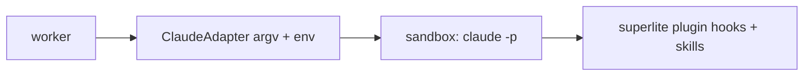
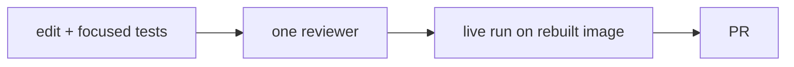

# Headless superlite runs: review plan

Approved in chat on 2026-11-23 ("yes for 2"). This is a small change, built inline with one reviewer.

## Summary

Claude runs in the sandbox never actually ran superlite. `--bare` removed the plugin's hooks and the Skill and Task tools, and `acceptEdits` blocked every shell command. This change drops both and keeps the untrusted cloned repo from loading its own hooks or MCP servers.

## What you will get

- Claude runs load superlite skills, dispatch subagents and can run tests and `superlite-cli`.
- A repo's `.claude/settings.json` hooks and `.mcp.json` servers never run in the sandbox.
- `SECURITY.md` describes the new model. `docs/notes/2026-11-23-headless-superlite-runs.md` records the measurements and the follow-ups.

## What will be built

| Part | What it does (one sentence) | Size (S/M/L) | Built by |
|---|---|---|---|
| Claude command line | `--setting-sources user --strict-mcp-config --permission-mode bypassPermissions`, no `--bare` | S | inline |
| Live driver | `drivers/claude.py` (the path real runs use) gets the same flags via the shared `CLAUDE_ISOLATION` | S | inline |
| Stay in `/work` | the driver disallows `EnterWorktree`/`ExitWorktree` and appends a note naming the run's session, so the hand-back sees the work | S | inline |
| Sandbox env | adapters declare fixed non-secret env; Claude gets `IS_SANDBOX=1` and `SUPERLITE_NO_AUTOCOMPACT=1` | S | inline |
| Tests | updated argv test plus an isolation regression test | S | inline |
| Docs | SECURITY.md and the notes doc | S | inline |

## How it fits together



## Key code changes

```python
env = {"IS_SANDBOX": "1"}
argv = ["claude", "-p", "--setting-sources", "user", "--strict-mcp-config",
        "--plugin-dir", "/opt/superlite", "--output-format", "stream-json", "--verbose",
        "--permission-mode", "bypassPermissions"]
```

## How it gets built



## Decisions you can change

- Permissions: `bypassPermissions` in the sandbox (default) | an allow list.

## Risks

- The agent can run anything in the sandbox, including reading its API key. This is documented in SECURITY.md; follow-ups are gVisor, restricted egress, and spend-limited keys.

## Out of scope

Egress limits, per-run budget caps, pre-set superlite setup answers, toolchains in the image.

## How we will know it works

- The focused tests and CI pass.
- A live `--superlite` run through the local server loads superlite skills, runs tests, and hands back its branch from `/work`.

## Rough time and cost

Under an hour; a few dollars of live runs.
