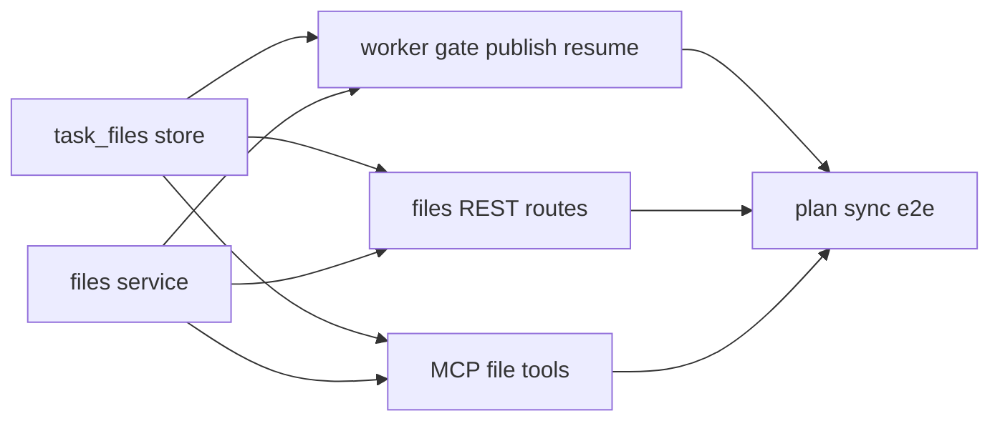

# Cloud plan sync integration (superlite-cloud)

**Goal:** Port the approved cloud-plan-sync prototype into slcloud: a `task_files` store, a files service over the repo cache, the worker gate/publish/resume, four REST routes and three MCP tools, so a waiting run's branch can be pulled, edited, pushed and approved. Server and worker only; the client is a second build.
**Architecture:** the worker commits the checkout at the plan gate and copies it into the bare repo cache as `refs/runs/<id>/gate`; `loop_once` serves publish requests (push to origin, bundle fallback); the API and MCP read and write the cache (`refs/runs/<id>/edits`, fast-forward only); on resume the worker fast-forwards the checkout to the edits through the sandbox and names the edited files in the answer.
**Tech stack:** Python 3.12, FastAPI, mcp (FastMCP), pytest, git
**Detail:** contracts
**Full suite:** yes
**Target-min:** 6
**Ignore:** .venv/, *.db, work/, .superlite/sandboxes/
**Review plan:** docs/plans/2026-11-17-cloud-plan-sync.feature.md

## Global constraints

- Port, never merge: the reference is `S` = `/Users/iheatuwogu/Projects/supers/superlite-cloud/.superlite/sandboxes/cloud-plan-sync/cloud-plan-sync/` (`S/proto/*.py`, `S/tests/*.py`). Read it; never import from it, never copy `paths.py`, `stand.py` or any stub or fake. Nothing under `S` is in any Owns.
- Test command: `.venv/bin/python -m pytest -q -m "not slow"`. Local git on `tmp_path` and local subprocesses only; no network.
- Branch `superlite/sessions/<slug>`. Cache refs `refs/runs/<id>/gate`, `refs/runs/<id>/edits`, `refs/runs/<id>/incoming` in `repocache.cache_for(data_dir, ws, repo)`.
- Plans = paths under `docs/plans/` ending `.md` that differ between the run's base and its gate sha.
- A run the caller may not see: 404 `{"error": "not found"}` via `runs.get_run`, never 403. Run not `waiting`: 409. Edit not a strict fast-forward of the gate sha: 409. Bad path or empty body: 400.
- No host git inside a run dir (`test_no_git_in_run_dir`): the worker touches the checkout only through `_Sandbox.sh`; host git uses `-C <cache.path>`.
- Frozen: existing REST routes and bodies, MCP tool names and arguments, `Task.public()` keys, `HandBack` fields, the `{"error"}` shape. Secrets masked in all output.
- Examples: run `t_1` named `login_fix`, slug `login-fix`, plan `docs/plans/2026-11-24-login-fix.review.md`, members `m_pat` and `m_chris`, workspace `w_ab12`.

## File structure

store.py `task_files` DDL · filestore.py gate, publish and edit rows · files.py cache reads, bundles, fast-forward edits · worker.py gate, publish job, resume · files_api.py four routes · mcp_server.py three tools · tests/test_plan_sync_e2e.py worker + api + mcp seam

## Core

### T1 task_files store · Complexity 2 · Est. context 16k
**Owns:** src/slcloud/filestore.py, src/slcloud/store.py, tests/test_filestore.py
**Components:** 1
**LOC owned:** 100
**Tests:** fast
**Kind:** mechanical
**Model:** haiku
**Consumes:** none
**Produces:** filestore.request_publish(store, task_id: str) -> str · filestore.pending(store) -> list[str] · filestore.set_gate(store, task_id: str, branch: str, sha: str, pushed: bool, plans: list[str], bundle: str = "") -> None · filestore.set_gate_sha(store, task_id: str, sha: str, plans: list[str]) -> None · filestore.get(store, task_id: str) -> dict | None · filestore.set_edits(store, task_id: str, sha: str, files: list[str]) -> None · filestore.clear(store, task_id: str) -> None
e.g. request_publish(store, "t_1") -> "pending"; again -> "pending"; after set_gate -> "ready"
e.g. pending(store) -> ["t_1"] after request_publish; [] after set_gate
e.g. get(store, "t_1") -> {"task_id": "t_1", "state": "ready", "branch": "superlite/sessions/login-fix", "sha": "9f2c1a7e...", "pushed": True, "bundle": "", "plans": ["docs/plans/2026-11-24-login-fix.review.md"], "edits": None}
e.g. after set_edits(store, "t_1", "ab12cd34...", ["README.md"]): get(...)["edits"] -> {"sha": "ab12cd34...", "files": ["README.md"]}; get(store, "t_9") -> None
**Review Focus:** test_publish_idempotent; test_gate_keeps_plans_after_publish; test_edits_replace; test_clear; test_schema_has_task_files: a fresh `Store` lists `task_files` in sqlite_master
**Test code (contracts):** port `S/tests/test_filestore.py` onto a real `slcloud.store.Store(str(tmp_path/"s.db"))`, plus test_schema_has_task_files
**Probe entry:** none - library module, covered by its tests
**Notes:** Port `S/proto/filestore.py`. The `CREATE TABLE IF NOT EXISTS task_files(...)` line moves into `store.SCHEMA` (no migrations); drop `ensure` and its calls. Keep states `gated`, `pending`, `ready` and JSON lists for plans and edits_files.

### T2 files service · Complexity 4 · Est. context 24k
**Owns:** src/slcloud/files.py, tests/test_files.py
**Components:** 1
**LOC owned:** 290
**Tests:** fast
**Model:** sonnet
**Consumes:** none
**Produces:** files.NotFastForward(Exception) · files.gate_ref(task_id: str) -> str · files.edits_ref(task_id: str) -> str · files.list_files(cache, sha: str) -> list[str] · files.read_file(cache, sha: str, path: str) -> str · files.changed(cache, base: str, sha: str) -> list[str] · files.make_bundle(cache, task_id: str, out: str) -> str · files.accept_bundle(cache, task_id: str, gate_sha: str, bundle_path: str) -> tuple[str, list[str]] · files.accept_remote(cache, task_id: str, gate_sha: str, sha: str) -> tuple[str, list[str]] · files.write_file(cache, task_id: str, gate_sha: str, path: str, text: str) -> tuple[str, list[str]] · files.drop_refs(cache, task_id: str) -> None
e.g. gate_ref("t_1") -> "refs/runs/t_1/gate"; edits_ref("t_1") -> "refs/runs/t_1/edits"
e.g. write_file(cache, "t_1", gate, "docs/plans/2026-11-24-login-fix.review.md", "# v2\n") -> ("ab12cd34...", ["docs/plans/2026-11-24-login-fix.review.md"])
e.g. accept_remote(cache, "t_1", gate, gate) raises NotFastForward("no new commits"); a sha without gate in its history raises NotFastForward("not a fast-forward of the gate commit")
e.g. drop_refs(cache, "t_1") deletes gate, edits and incoming refs; then `git update-ref refs/runs/t_1 <sha>` succeeds
**Review Focus:** test_write_file_stacks; test_bundle_roundtrip; test_rewrite_refused (edits ref unchanged); test_read_missing (NotFound); test_path_escape (ValueError for "../x", "/x", ".git/x"); test_drop_refs_frees_run_ref
**Test code (contracts):** port `S/tests/test_files.py` (cache = `RepoCache(str(tmp_path/"c.git"), origin)` on a local bare origin), plus test_drop_refs_frees_run_ref
**Probe entry:** none - library module, covered by its tests
**Notes:** Port `S/proto/files.py` as is (git `-C cache.path` only, temp index for write_file, `cache.lock()` around ref writes, `_clean` path rules). Add `drop_refs`: `cache.drop_ref` on the three refs, because `refs/runs/<id>` (hand-back) cannot coexist with `refs/runs/<id>/gate`.

### T3 worker gate, publish and resume · Complexity 6 · Est. context 34k
**Owns:** src/slcloud/worker.py, tests/test_worker_files.py
**Components:** 1
**LOC owned:** 230
**Tests:** fast
**Model:** sonnet
**Consumes:** filestore.set_gate_sha, filestore.pending, filestore.set_gate, filestore.get, filestore.clear, files.gate_ref, files.edits_ref, files.changed, files.drop_refs
**Produces:** worker.publish_pending(deps) -> bool · worker.answer_for(answer: str, edited: list[str]) -> str · events `plan` {plans} and `published` {branch, sha, pushed}
e.g. answer_for("approve", ["README.md", "docs/plans/x.review.md"]) -> "approve\n\nBefore approving, the user edited these files on the branch: README.md, docs/plans/x.review.md. Reread them before you build."
e.g. answer_for("approve", []) -> "approve"
e.g. after the gate: filestore.get(store, "t_1") -> {"state": "gated", "sha": <gate>, "plans": ["docs/plans/2026-11-24-login-fix.review.md"], ...}; events end with `plan` then the move to `waiting`
e.g. publish_pending(deps) after request_publish -> True; origin has `superlite/sessions/login-fix` at the gate sha; get(...)["state"] -> "ready", pushed True
**Review Focus:** test_gate_commits_and_records_plans; test_gate_no_host_git_in_run_dir (keep `test_no_git_in_run_dir` green); test_publish_pushes_branch; test_publish_bundle_fallback (origin refuses: pushed False, bundle under `data_dir/bundles/t_1.gate.bundle`); test_publish_before_claim (loop_once serves a pending publish before claiming); test_resume_fast_forwards_edits (checkout holds the edited text; first prompt is answer_for with the edited files); test_resume_without_edits_unchanged; test_handback_after_publish_keeps_name (final branch is `superlite/sessions/login-fix`, not `login-fix-2`)
**Test code (contracts):** reuse the `tests/test_worker.py` env fixture style (bare origin, FAKE_CLAUDE writing a plan file and the marker, FAKE_CLI) in `tests/test_worker_files.py`; port the cases of `S/tests/test_worker_files.py`
**Probe entry:** `slcloud worker` loop (`app.run_worker` -> `loop_once`)
**Notes:** Port `S/proto/worker_files.py` into worker.py. Gate (at the PLAN_MARK branch, before `transition(waiting)`): `sb.sh(["sh","-c",_COMMIT], {**_GIT_ENV,"SL_MSG":"superlite: plan gate"})`; under `cache.lock()` `cache.fetch_from(run_dir, <branch>, into=files.gate_ref(id))`; plans = `files.changed(cache, <base sha>, gate)` filtered to `docs/plans/*.md`; `set_gate_sha`; `add_live_event(id, "plan", {"plans": plans})`. Publish (`publish_pending`, called first in `loop_once`): per pending id, branch `superlite/sessions/<slug(name)>`, `cache.push(gate_ref, branch, expect="")`; refused -> `cache.bundle(gate_ref, data_dir/bundles/<id>.gate.bundle)`; `set_gate`; `published` event. Resume: when resuming and `get(...)["edits"]`, through `sb.sh` run `git fetch -q <cache.path> <edits_ref>` then `git merge --ff-only -q FETCH_HEAD`; prompt = `answer_for(task.answer, edited)`; then `files.drop_refs` and `filestore.clear`. Hand-back passes `own={task.name}` when the row was pushed, so the lease uses the published tip instead of renaming.

### T4 files REST routes · Complexity 4 · Est. context 24k
**Owns:** src/slcloud/files_api.py, src/slcloud/api.py, tests/test_files_api.py
**Components:** 1
**LOC owned:** 260
**Tests:** fast
**Model:** sonnet
**Consumes:** filestore.request_publish, filestore.get, filestore.set_edits, files.list_files, files.make_bundle, files.accept_bundle, files.accept_remote, files.NotFastForward
**Produces:** files_api.make_files_router(store, engine, whoami, settings) -> APIRouter · POST /api/tasks/{ref}/publish · GET /api/tasks/{ref}/files · GET /api/tasks/{ref}/files/bundle · POST /api/tasks/{ref}/files
e.g. POST /api/tasks/t_1/publish -> 202 {"state": "pending"}; once published -> 200 {"state": "ready", "branch": "superlite/sessions/login-fix", "sha": "9f2c...", "pushed": true, "via": "remote", "files": [...], "plans": ["docs/plans/2026-11-24-login-fix.review.md"], "edits": null}
e.g. POST /api/tasks/t_1/files {"sha": "ab12..."} -> 200 with edits {"sha": "ab12...", "files": ["README.md"]}; a rewrite -> 409 {"error": "not a fast-forward of the gate commit"}
e.g. GET /api/tasks/t_1/files by m_chris on m_pat's run -> 404 {"error": "not found"}
**Review Focus:** test_routes_before_greedy (GET /files is not swallowed by `GET /api/tasks/{ref:path}`); test_publish_202_then_ready; test_never_published_409; test_not_waiting_409; test_bundle_download_and_upload; test_base_mismatch_409; test_empty_body_400; test_other_member_404; test_existing_api_unchanged (tests/test_api.py green)
**Test code (contracts):** port `S/tests/test_routes.py` against the real `api.create_app(settings, store, engine, whoami)` via TestClient
**Probe entry:** `slcloud serve` -> `app.build` -> `api.create_app`
**Notes:** Port `S/proto/routes.py`. The cache comes from `repocache.cache_for(settings.data_dir, task.workspace, task.repo)`; bundles under `settings.data_dir/bundles`. In `api.create_app` include the router before any `/api/tasks/{ref:path}` route. Error map: NotFound 404, BadTransition and NotFastForward 409, ValueError 400.

### T5 MCP file tools · Complexity 3 · Est. context 20k
**Owns:** src/slcloud/mcp_server.py, tests/test_mcp_files.py
**Components:** 1
**LOC owned:** 120
**Tests:** fast
**Model:** sonnet
**Consumes:** filestore.get, filestore.set_edits, files.list_files, files.read_file, files.write_file, files.NotFastForward
**Produces:** MCP tools list_files(ref) -> {files} · read_file(ref, path) -> {path, text} · write_file(ref, path, text) -> {sha, files}
e.g. read_file("t_1", "docs/plans/2026-11-24-login-fix.review.md") -> {"path": "...", "text": "# Login fix\n"}
e.g. write_file("t_1", "docs/plans/2026-11-24-login-fix.review.md", "# v2\n") -> {"sha": "ab12...", "files": ["docs/plans/2026-11-24-login-fix.review.md"]}
e.g. list_files on an unpublished run -> {"error": "files not published yet"}; another member's run -> {"error": "not found"}
**Review Focus:** test_tools_registered (build_mcp lists the three new names and every old one); test_write_then_files_shows_edit; test_not_waiting_error; test_path_escape_error; test_other_member_not_found; tests/test_mcp.py green
**Test code (contracts):** port `S/tests/test_mcp_files.py` onto `mcp_server.tools(eng, store, settings, who)`
**Probe entry:** MCP at `/mcp` (`app.build` -> `build_mcp`)
**Notes:** Port `S/proto/mcp_files.py` into `tools()`; add the three to `fns`. Extend `guard`: NotFastForward and ValueError -> `{"error": str(e)}`.

### T6 plan sync e2e · Complexity 4 · Est. context 26k
**Owns:** tests/test_plan_sync_e2e.py
**Components:** 1
**LOC owned:** 220
**Tests:** fast
**Model:** sonnet
**Consumes:** worker.loop_once, worker.publish_pending, files_api routes, MCP tools
**Produces:** none
e.g. submit -> loop_once (gate) -> POST publish -> loop_once (publish) -> GET files -> push edit to origin -> POST files {sha} -> respond approve -> loop_once (resume) -> first prompt names both files, checkout holds the edit
**Review Focus:** test_check1_pull_whole_branch; test_check3_edits_recorded; test_check4_resume_names_files; test_check5_branch_only_after_publish; test_check6_mcp_write; test_check7_bundle_fallback (`via: slcloud`); test_check8_push_after_cancel_409; test_check9_other_member_404; test_check10_rewrite_409
**Test code (contracts):** port the server-side cases of `S/tests/test_acceptance.py` onto the real worker env (as in tests/test_worker.py), the real `create_app` via TestClient and `mcp_server.tools`
**Probe entry:** none - test only
**Notes:** No stubs beyond what tests/test_worker.py already fakes (agent CLI, superlite CLI). Check 2 and the client side of checks 1, 3 and 7 belong to the client build.
