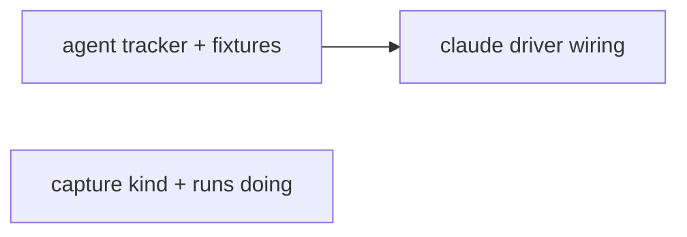

# Cloud agent panel integration (superlite-cloud)

**Goal:** Port the approved agent tracker into slcloud so a Claude-driven cloud run emits `agent` events (start, update, done, failed) that are captured, stored and streamed like any other event, and `live_runs.doing` describes them. Server side only; the panel in `cloud watch` is the plugin build.
**Architecture:** `ClaudeDriver.events(line)` feeds each parsed stream-json line to a per-driver `AgentTracker` and appends its events (`{"kind": "agent", ...}`) after the existing text/thinking/tool/status events; `Capture` accepts kind `agent`; `runs._doing` gets an `agent` branch.
**Tech stack:** Python 3.12, pytest
**Detail:** contracts
**Full suite:** yes
**Target-min:** 4
**Ignore:** .venv/, *.db, work/, .superlite/sandboxes/
**Review plan:** docs/plans/2026-11-27-cloud-agent-panel.feature.md

## Global constraints

- Port, never merge: the reference is `S` = `.superlite/sandboxes/cloud-agent-panel/cloud-agent-panel/` (`S/src/agents.py`, `S/tests/test_agents.py`, `S/fixtures/*.jsonl`). Read it; never import from it; nothing under `S` is in any Owns. Fixture files may be copied byte for byte.
- Test command: `.venv/bin/python -m pytest -q -m "not slow"`. No network.
- Wire event (frozen, also read by the plugin): `{"kind": "agent", "id": str, "parent": str|None, "type": str, "tier": "haiku"|"sonnet"|"opus"|"?", "task": str, "state": "start"|"update"|"done"|"failed", "tokens": int}`. Only `kind`, `id`, `state` are guaranteed; consumers tolerate missing keys.
- Frozen: `Driver` base API (`argv`, `user_line`, `observe`, `events`), the existing event kinds and their data, `live_runs` keys, the events table, SSE format.
- Examples: Agent tool_use id `toolu_01CCzTk6ChrKFXqbJGzyq8AH` (A) and `toolu_013vSWEaVAkM9DRxP7amjwkR` (B) from `S/fixtures/sample.jsonl`; both `general-purpose`, tier `haiku`, end tokens A 17875, B 16341.

## File structure

drivers/agents.py tracker · drivers/claude.py tracker wiring · capture.py `_KINDS` · runs.py `_doing` · tests/fixtures stream samples + expected events (the plugin seam)

## Core

### T5 agent tracker and fixtures · Complexity 4 · Est. context 22k
**Owns:** src/slcloud/drivers/agents.py, tests/test_agents.py, tests/fixtures/claude_stream_agents.jsonl, tests/fixtures/claude_stream_nested.jsonl, tests/fixtures/agent_events.json
**Components:** 1
**LOC owned:** 260
**Tests:** fast
**Model:** sonnet
**Consumes:** none
**Produces:** slcloud.drivers.agents.AgentTracker(clock: Callable[[], float] = time.monotonic, gap: float = 5.0) · AgentTracker.feed(line: dict) -> list[dict] · tests/fixtures/agent_events.json (the tracker's full output for claude_stream_agents.jsonl with a fixed clock, one JSON list)
e.g. feeding claude_stream_agents.jsonl: starts for A then B, each `{"kind": "agent", "id": A, "parent": None, "type": "general-purpose", "tier": "haiku", "task": "...", "state": "start", "tokens": 0}`; ends `done` with tokens 17875 (A) and 16341 (B); no end for B before its task_notification
e.g. feed("garbage") -> []; feed({"type": "system", "subtype": "task_notification", "tool_use_id": X, "status": "stopped"}) for a started X -> one event state "failed"
**Review Focus:** test_sample_two_agents; test_background_not_ended_by_async_launched; test_nested_parents; test_stopped_is_failed; test_update_throttle; test_foreground_result_ends_once; test_garbage_lines; test_expected_events_fixture (agent_events.json equals a fresh run with the fixed clock, so the plugin seam copy cannot drift silently)
**Test code (contracts):** port `S/tests/test_agents.py` with fixtures read from `tests/fixtures/` (copy `S/fixtures/sample.jsonl` -> `claude_stream_agents.jsonl`, `S/fixtures/nested.jsonl` -> `claude_stream_nested.jsonl`); add test_expected_events_fixture
**Probe entry:** none - library module, covered by its tests
**Notes:** Port `S/src/agents.py` as is; every emitted event carries `"kind": "agent"` (add it if the sandbox omits it). Generate agent_events.json with a clock that advances 1.0 per call starting at 0.0 and gap 5.0; write it with `json.dumps(events, indent=1)`; the test regenerates and compares. Keep `feed` total: any exception -> [].

### T6 claude driver wiring · Complexity 2 · Est. context 14k
**Owns:** src/slcloud/drivers/claude.py, tests/test_drivers.py
**Components:** 1
**LOC owned:** 60
**Tests:** fast
**Model:** sonnet
**Consumes:** AgentTracker, AgentTracker.feed
**Produces:** ClaudeDriver.events(line) additionally returns the tracker's agent events, after the line's existing events
e.g. events(<the task_started line for A>) -> [{"kind": "agent", "id": A, "state": "start", ...}]
e.g. events(<a result line>) -> [{"kind": "status", "status": "done"}] (unchanged, plus any agent events the tracker ends on it)
**Review Focus:** test_claude_agent_events_from_fixture (feed claude_stream_agents.jsonl through `ClaudeDriver.events`: agent starts A, B; ends done; every existing text/tool/status test unchanged); test_tracker_per_driver (two drivers do not share state); test_events_non_assistant_lines_still_parse (system lines yield agent events but no text)
**Test code (contracts):** extend `tests/test_drivers.py` with the cases above using the existing `make` helper
**Probe entry:** `slcloud worker` loop (`worker.py` `driver.events` -> `cap.feed`)
**Notes:** Create the tracker lazily on first `events` call (`self._agents`), so `Driver.__init__` stays untouched. Parse with `_json(line)` once; on non-dict -> []. The early `result` return must still append tracker events; keep the existing block parsing for `assistant` lines identical.

### T7 capture kind and runs doing · Complexity 1 · Est. context 10k
**Owns:** src/slcloud/capture.py, src/slcloud/runs.py, tests/test_capture.py, tests/test_runs.py
**Components:** 1
**LOC owned:** 40
**Tests:** fast
**Kind:** mechanical
**Model:** haiku
**Consumes:** none
**Produces:** Capture.feed accepts kind "agent" (strings masked, ints and None kept) · runs._doing("agent", data) -> "<type>: <task>"
e.g. Capture.feed({"kind": "agent", "id": "a1", "parent": None, "type": "implementer", "tier": "sonnet", "task": "T7 · panel", "state": "start", "tokens": 0}) -> add_event(task_id, "agent", {"step": 1, "id": "a1", "parent": None, "type": "implementer", "tier": "sonnet", "task": "T7 · panel", "state": "start", "tokens": 0})
e.g. a task string containing a secret is masked like any other string field
e.g. _doing("agent", {"type": "implementer", "task": "T7 · panel"}) -> "implementer: T7 · panel"; _doing("agent", {}) -> None
**Review Focus:** test_agent_kind_captured; test_agent_secret_masked; test_agent_keeps_ints_and_none; test_doing_agent; existing capture and runs tests green
**Test code (contracts):** add the cases above to tests/test_capture.py and tests/test_runs.py
**Probe entry:** none - covered by tests
**Notes:** capture.py: add `"agent"` to `_KINDS` (line 20) only. runs.py `_doing`: add `elif kind == "agent": text = f"{data.get('type') or ''}: {data.get('task') or ''}".strip(": ").strip()` before the else, keeping the empty -> None rule.
