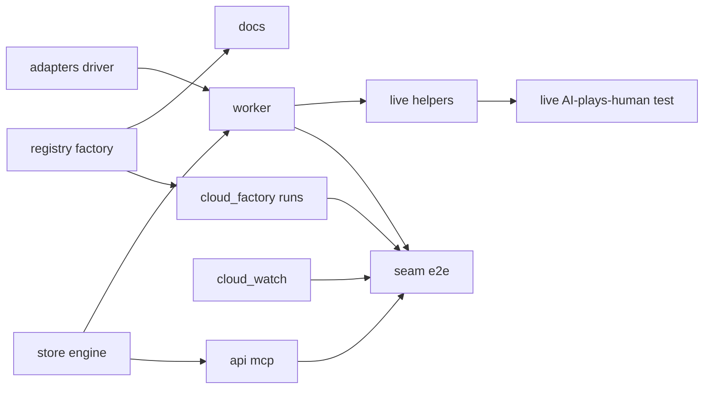

# Human orchestration integration build

**Goal:** Port the approved prototype into superlite-cloud (`src/slcloud`) and superlite (`skills/swarm/scripts`): Human cloud runs stop on `Reply to answer` questions and on the plan, answered from watch or attach; AI runs unchanged.
**Architecture:** server fields + idempotent migration in store/engine, `orchestrator` on api/mcp, question marker in adapters, orchestrator-aware headless note, worker question branch; client flag + saved default, mode-aware preamble, send body, runs display, watch answer routing.
**Tech stack:** Python 3.12, FastAPI, pytest, git; client stdlib only
**Detail:** contracts
**Full suite:** yes
**Ignore:** .venv/, .claude/
**Review plan:** docs/plans/2026-11-27-human-orchestration.feature.md

## Global constraints

- `PROTO` = `/Users/iheatuwogu/Projects/supers/superlite-cloud/.superlite/sandboxes/human-orchestration/human-orchestration` (read only). Its `overlay/slcloud/*.py` and `client/*.py` are full copies of the real files with `# PROTO:` comments at each change. Port each `# PROTO:` hunk into the real file by hand (drop the `# PROTO:` tags); never copy a whole prototype file, never port `stand.py`, `fake/`, `bin/`, `run.sh` or the `_REAL_CLI` sys.path hacks.
- `SL` = `/Users/iheatuwogu/Projects/supers/superlite-ho` (superlite worktree, branch `superlite/human-orchestration`); `S` = `SL/skills/swarm/scripts`. Cloud paths are relative to this worktree.
- Cloud tests: `.venv/bin/python -m pytest -q <paths>` from this worktree (or `bash "$CLI" run_tests --fast <paths>`). Superlite tests: `cd SL && /Users/iheatuwogu/Projects/supers/superlite-cloud/.venv/bin/python -m pytest -q <paths>`.
- FROZEN: existing routes and fields, `respond`/`nudge` semantics, `PLAN_MARKER`, `_gate` behaviour, existing event kinds, existing `send`/`use` flags, AI preamble byte for byte, `cloud_client` API, `cloud_hook` routing rules. `cloud*.py` stay stdlib only.
- `QUESTION_MARKER = "Reply to answer"` (last non-empty line); `PLAN_MARKER = "Reply approve to start"` wins when both appear. `orchestrator` in {"ai","human"}, NULL reads "ai"; `waiting_on` in {"question","plan",None}; both in `Task.public()`.
- Examples: run `login_fix`, prompt `fix the login bug`, question `Which login page: web or mobile?`, answer `web`.
- Every existing test in both repos stays green.

## Server (superlite-cloud)

### T1 store and engine fields · Complexity 3 · Est. context 22k
**Owns:** src/slcloud/store.py, src/slcloud/engine.py, tests/test_store.py, tests/test_engine.py
**Components:** 1
**LOC owned:** 70
**Tests:** fast
**Model:** sonnet
**Consumes:** PROTO/overlay/slcloud/store.py, PROTO/overlay/slcloud/engine.py
**Produces:** Task.orchestrator (str, default "ai") · Task.waiting_on (str|None) · Engine.submit(..., orchestrator="ai") raising ValueError on other values · Engine.transition(..., waiting_on=...) · store idempotent ALTER adds `orchestrator TEXT`, `waiting_on TEXT`
e.g. submit(..., orchestrator="robot") -> ValueError; submit(...) -> task.orchestrator == "ai"; old row with NULL orchestrator -> "ai"
e.g. respond on a waiting task clears waiting_on; any transition to a status other than "waiting" clears waiting_on (cancel included)
**Review Focus:** test_orchestrator_default_ai; test_orchestrator_rejected; test_old_db_migrates (create the pre-change schema, open with new store, old rows read "ai"); test_migration_idempotent (open twice); test_public_has_fields; test_respond_clears_waiting_on; test_cancel_clears_waiting_on
**Test code (contracts):** extend tests/test_store.py and tests/test_engine.py
**Probe entry:** slcloud.engine
**Notes:** The prototype's cancel path left `waiting_on` set; fix it here (transition to non-waiting clears it).

### T2 api and mcp orchestrator field · Complexity 2 · Est. context 18k
**Owns:** src/slcloud/api.py, src/slcloud/mcp_server.py, tests/test_api.py, tests/test_mcp.py
**Components:** 1
**LOC owned:** 30
**Tests:** fast
**Model:** sonnet
**Consumes:** Engine.submit(..., orchestrator="ai") raising ValueError on other values, Task.public()
**Produces:** POST /api/tasks body `orchestrator` (default "ai", other -> 400 via `Rejected`) · MCP submit_task(..., orchestrator="ai")
e.g. POST {"orchestrator":"robot"} -> 400; POST {"orchestrator":"human"} -> task json has "orchestrator":"human","waiting_on":null
**Review Focus:** test_submit_orchestrator_human; test_submit_orchestrator_rejected; test_list_has_orchestrator; test_mcp_submit_human
**Test code (contracts):** extend tests/test_api.py, tests/test_mcp.py
**Probe entry:** slcloud.api

### T3 adapters marker and claude driver note · Complexity 3 · Est. context 20k
**Owns:** src/slcloud/adapters.py, src/slcloud/drivers/claude.py, tests/test_adapters.py, tests/test_drivers.py
**Components:** 1
**LOC owned:** 60
**Tests:** fast
**Model:** sonnet
**Consumes:** PROTO/overlay/slcloud/adapters.py, PROTO/overlay/slcloud/drivers/claude.py
**Produces:** adapters.QUESTION_MARKER · adapters.is_question(text) -> bool · headless_note(slug, workdir="/work", orchestrator="ai") -> str · ClaudeDriver.orchestrator attribute (default "ai") · AskUserQuestion in --disallowedTools for every run
e.g. is_question("Which login page: web or mobile?\nReply to answer") -> True; with PLAN_MARKER also present -> False; "all done" -> False
e.g. headless_note("login-fix") is byte-identical to today's; the human note contains "A human answers questions", "Reply to answer", "never use AskUserQuestion", "superlite-cli orchestrator set human"
**Review Focus:** test_is_question; test_plan_marker_wins; test_note_ai_unchanged (compare to a literal copy of today's text); test_note_human; test_ask_user_question_disallowed
**Test code (contracts):** extend tests/test_adapters.py, tests/test_drivers.py
**Probe entry:** slcloud.adapters

### T4 worker question wait and e2e flow · Complexity 5 · Est. context 32k
**Owns:** src/slcloud/worker.py, tests/test_worker.py, tests/test_e2e.py
**Components:** 1
**LOC owned:** 120
**Tests:** fast
**Model:** sonnet
**Consumes:** Task.orchestrator, transition(waiting_on=), adapters.is_question, ClaudeDriver.orchestrator, PROTO/overlay/slcloud/worker.py, PROTO/tests/test_worker_question.py, PROTO/tests/test_acceptance.py
**Produces:** event `question` {run, text} · waiting_on "question" (no `_gate`) · `_gate` path sets waiting_on "plan"
e.g. Human first turn ending "Reply to answer": event question {"run":"login_fix","text":"Which login page: web or mobile?"}, status waiting, waiting_on "question", no gate commit
e.g. same text in an AI run: no question event, status done as today
**Review Focus:** test_question_waits; test_question_ignored_for_ai; test_plan_sets_waiting_on_plan; test_answer_resumes (respond "web" -> queued -> next prompt "web" with --resume); e2e test_flow_human_question_then_plan (question -> answer -> plan -> approve -> done)
**Test code (contracts):** FAKE_CLAUDE in tests/test_worker.py gains a question prompt prefix; e2e flow in tests/test_e2e.py next to test_flow_approve
**Probe entry:** worker.loop_once
**Notes:** After `get_driver(...)` set `driver.orchestrator = task.orchestrator`. Event text = result minus the marker line, stripped. Emit `question` before the transition to waiting.

### T10 live test helpers · Complexity 3 · Est. context 18k
**Owns:** tests/live_helpers.py
**Components:** 1
**LOC owned:** 60
**Tests:** fast
**Model:** sonnet
**Consumes:** worker.loop_once, POST /api/tasks orchestrator, respond/approve routes, event `question`
**Produces:** live_helpers.live_ready() -> (bool, reason) (True only when `claude` is on PATH and `SLCLOUD_LIVE=1`) · live_helpers.ask_ai_human(question, timeout=120) -> str (a second `claude -p` playing the human; returns its one-line answer) · live_helpers.wait_for(client, run, pred, timeout) -> dict (polls the task json until pred holds, else TimeoutError)
e.g. live_ready() with SLCLOUD_LIVE unset -> (False, "set SLCLOUD_LIVE=1 to run live tests")
**Review Focus:** bounded timeouts; no secrets in logs or exceptions; no subprocess or network at import
**Test code (contracts):** none of its own; T11 covers it
**Probe entry:** none
**Notes:** Reuse the e2e setup helpers in tests/test_e2e.py by import where possible.

### T11 live AI-plays-human test · Complexity 3 · Est. context 20k
**Owns:** tests/test_live_human.py
**Components:** 1
**LOC owned:** 60
**Tests:** slow
**Model:** sonnet
**Consumes:** live_helpers.live_ready, live_helpers.ask_ai_human, live_helpers.wait_for
**Produces:** tests/test_live_human.py marked `pytest.mark.slow`, skipped with live_ready()'s reason unless ready
e.g. a Human run with real `claude -p` whose prompt asks it to ask one question ending `Reply to answer`; the test reads the `question` event, answers with ask_ai_human, responds, then on `waiting_on == "plan"` approves, and asserts the run reaches done and the next turn used the answer
**Review Focus:** never runs in the default `-m "not slow"` suite; clear skip reason; use the real claude driver, not FAKE_CLAUDE
**Test code (contracts):** tests/test_live_human.py
**Probe entry:** none

## Client (superlite, at SL)

### T5 registry and factory orchestrator flag · Complexity 4 · Est. context 26k
**Owns:** /Users/iheatuwogu/Projects/supers/superlite-ho/skills/swarm/scripts/factory.py, /Users/iheatuwogu/Projects/supers/superlite-ho/skills/swarm/scripts/factory_registry.py, /Users/iheatuwogu/Projects/supers/superlite-ho/skills/swarm/scripts/factory_api.py, /Users/iheatuwogu/Projects/supers/superlite-ho/tests/scripts/test_factory_registry.py, /Users/iheatuwogu/Projects/supers/superlite-ho/tests/scripts/test_factory_api.py, /Users/iheatuwogu/Projects/supers/superlite-ho/tests/scripts/test_factory_cli_e2e.py
**Components:** 1
**LOC owned:** 90
**Tests:** fast
**Model:** sonnet
**Consumes:** PROTO/client/factory_api.py, PROTO/client/sl.py (flag behaviour only)
**Produces:** `factory send ... --orchestrator human|ai` · `factory use <name> --orchestrator human|ai` (saved per factory, shown by `factory list`) · factory_registry.orchestrator_default(name) -> "ai"|"human" · factory_api.superlite_prompt(text, orchestrator="ai") · provider `send(..., orchestrator=...)`
e.g. superlite_prompt("x") is byte-identical to today's preamble + text; superlite_prompt("x", "human") contains "orchestrator set human" and not "orchestrator set ai"
e.g. use cloud --orchestrator human, then send with no flag -> orchestrator "human"; send --orchestrator ai overrides
**Review Focus:** test_preamble_ai_unchanged; test_preamble_human; test_send_flag_beats_default; test_use_saves_orchestrator; test_list_shows_orchestrator; non-cloud providers accept and ignore orchestrator
**Test code (contracts):** extend the three owned test files

### T6 cloud_factory send body and cloud runs display · Complexity 3 · Est. context 22k
**Owns:** /Users/iheatuwogu/Projects/supers/superlite-ho/skills/swarm/scripts/cloud_factory.py, /Users/iheatuwogu/Projects/supers/superlite-ho/skills/swarm/scripts/cloud.py, /Users/iheatuwogu/Projects/supers/superlite-ho/tests/scripts/test_cloud_factory.py, /Users/iheatuwogu/Projects/supers/superlite-ho/tests/scripts/test_cloud_cli.py
**Components:** 1
**LOC owned:** 60
**Tests:** fast
**Model:** sonnet
**Consumes:** factory_api.superlite_prompt, PROTO/client/cloud_factory.py, PROTO/client/cloud.py
**Produces:** cloud_factory.send(..., orchestrator="ai") puts "orchestrator" in the body only for human; warns `server does not support human orchestration; run is AI` when the reply lacks "orchestrator" · `cloud runs` shows `[human]` and `waiting: question|plan`
e.g. AI send body == today's body exactly; human send body has "orchestrator":"human"
**Review Focus:** test_body_ai_unchanged; test_body_human; test_old_server_warning; test_runs_human_tag; test_runs_waiting_on; the preamble-prefix check covers both modes

### T7 cloud_watch question render and answer routing · Complexity 4 · Est. context 24k
**Owns:** /Users/iheatuwogu/Projects/supers/superlite-ho/skills/swarm/scripts/cloud_watch.py, /Users/iheatuwogu/Projects/supers/superlite-ho/tests/scripts/test_cloud_watch.py, /Users/iheatuwogu/Projects/supers/superlite-ho/tests/scripts/test_cloud_hook.py
**Components:** 1
**LOC owned:** 70
**Tests:** fast
**Model:** sonnet
**Consumes:** event `question` {run, text}, status events, PROTO/client/cloud_watch.py, PROTO/tests/test_watch_question.py
**Produces:** render of kind `question` -> `? <text>` · WatchState shared by reader thread and input loop · plain line sent as respond while waiting on a question, else nudge as today; `/approve`, `/cancel` unchanged
e.g. render({"kind":"question","text":"Which login page: web or mobile?"}) -> "? Which login page: web or mobile?"
**Review Focus:** test_render_question; test_plain_line_answers_when_waiting_question; test_plain_line_nudges_when_running; test_approve_unchanged; cloud_hook: plain line while waiting goes as respond (test only, no cloud_hook change)

### T8 docs and md-parser tests · Complexity 2 · Est. context 16k
**Owns:** /Users/iheatuwogu/Projects/supers/superlite-ho/commands/send.md, /Users/iheatuwogu/Projects/supers/superlite-ho/commands/factory.md, /Users/iheatuwogu/Projects/supers/superlite-ho/skills/swarm/orchestrator.md, /Users/iheatuwogu/Projects/supers/superlite-ho/tests/scripts/test_factory_commands_md.py, /Users/iheatuwogu/Projects/supers/superlite-ho/tests/scripts/test_cloud_commands_md.py
**Components:** 1
**LOC owned:** 40
**Tests:** fast
**Model:** sonnet
**Consumes:** the T5 parser flags
**Produces:** send.md argument hint and text mention `--orchestrator human|ai`; factory.md documents `use --orchestrator`; orchestrator.md has a short "Cloud Human runs" section (question with `Reply to answer`, plan approval, answer from watch or attach)
**Review Focus:** md-parser tests match the real parser flags

## Seam

### T9 cross-repo seam e2e · Complexity 4 · Est. context 28k
**Owns:** tests/test_seam_human.py
**Components:** 1
**LOC owned:** 140
**Tests:** fast
**Model:** sonnet
**Consumes:** every Produces above, PROTO/tests/test_acceptance.py
**Produces:** tests/test_seam_human.py: the real superlite client (from `SUPERLITE_SCRIPTS`, default `SL/skills/swarm/scripts`; skip if missing) against a live in-process slcloud with the FAKE_CLAUDE from tests/test_worker.py, covering feature checks 1-6
e.g. send --orchestrator human -> `cloud runs` shows `[human]`; question -> `waiting: question`; answer via watch handle_input -> queued; plan -> `waiting: plan`; approve -> done; AI send never parks on `Reply to answer`; `use --orchestrator human` default then `--orchestrator ai` override
**Review Focus:** no network; temp HOME/config; each check its own test
